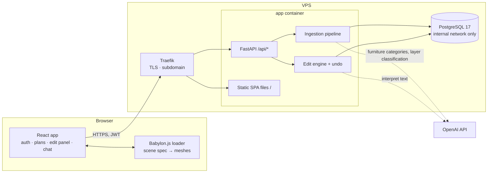
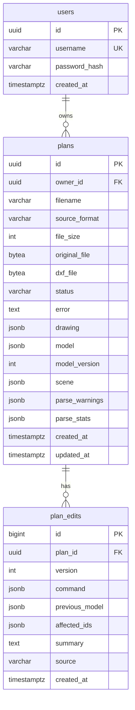

# Walkitecture — Architecture

> **Status (2026-11-07):** the backend pipeline, accounts, and editing are implemented (PR #2, see
> [`backend/README.md`](backend/README.md)). The single-image deployment behind Traefik is live at https://walkitecture.severyn.xyz with a placeholder
> frontend; the real frontend and the remaining LLM steps are not built yet. Items marked **PLANNED** below are still to do. The phased, parallel build order lives
> in [`IMPLEMENTATION_PLAN.md`](IMPLEMENTATION_PLAN.md).

## 1. Goals and non-goals

**Goal:** A logged-in user uploads a **DWG** floor plan. The server turns it into a semantic building model (walls,
doors, windows, rooms, furniture) and a render-ready Babylon.js scene spec, both stored in PostgreSQL. The browser
renders the spec as a walkable, first-person 3D scene. The user can change the building (window width, ceiling
height, …) with sliders or natural language **without reloading**.

**Non-goals (MVP):** photorealism, BIM/IFC export, building-code checks, LLM-generated geometry or code, PDF/image
uploads. (DXF uploads work too, but DWG is the product's input format.)

## 2. Decision log

| # | Decision | Choice | Why | Rejected alternatives |
| --- | --- | --- | --- | --- |
| D1 | How DWG is read | **LibreDWG 0.14 `dwg2dxf` → DXF → `ezdxf`**, compiled into the Docker image | ezdxf cannot parse DWG natively; `ezdxf.addons.odafc` (see `helper/read_dwg.py`) *also* converts to DXF under the hood. LibreDWG is open source, headless, and **reads both `/examples` DWGs correctly** (2018+ format) | ODA File Converter (proprietary, Qt + xvfb in Docker). Kept only as a fallback idea if a future DWG fails |
| D2 | What is stored per plan | Original upload, the converted DXF (cache, so re-parsing skips conversion), the **descriptive drawing JSON**, the **canonical building model**, and the **Babylon scene spec** | Every stage can be inspected and re-run; the DXF is an internal cache, never something the user has to provide | Re-converting the DWG on every re-parse |
| D3 | What the browser receives | **JSON only:** `{model, babylon}`. `model` = canonical building (source of truth for edits); `babylon` = render-ready boxes, glass panes, furniture placements, camera spawn, computed by the backend from `model`. One generic frontend loader turns the spec into meshes | No generated or stored code is ever executed in the browser; all geometry rules live in one tested Python module; the frontend stays thin | Generating Babylon.js *code* per DWG; computing wall sections in the frontend |
| D4 | LLM in ingestion | Rules first, LLM only for what rules cannot decide, and LLM output is always data validated by code. **Implemented:** category of unidentified furniture blocks. **PLANNED:** (1) classify unknown layers/blocks from the drawing JSON inventory into parse options; (2) review pass proposing allowlisted patches on the model | Raw drawings have thousands of entities — too big and noisy for an LLM to fix geometry directly. Names, counts, and sizes are small and are where an LLM adds most | LLM rewriting raw entity JSON; LLM placing geometry |
| D5 | Units & heights | **Meters.** All walls 10 ft = **3.048 m**; doors 0 → 7 ft (**2.134 m**); windows 2.5 → 6.5 ft (**0.762 → 1.981 m**) | Existing schema is metric; the UI can display feet | Storing feet |
| D6 | Furniture placement | **Rule-based:** match block → GLB by name (then footprint), size it from the drawing, align it to the INSERT's own axes, and turn its **back to the wall it stands against**; free-standing items face away from the nearest wall; **chairs near a table/desk face it**. LLM only names unknown blocks | DWG blocks have no shared "front" convention, so the wall rule is more reliable than trusting block rotation alone; rotation still gives the axes | Trusting the INSERT rotation as the facing; LLM placing furniture |
| D7 | Auth | **Username + password** (argon2id), **JWT bearer** tokens (HS256, 7 days, `JWT_SECRET`), `plans.owner_id` FK; every plan route scoped to the caller | Simple for a SPA; implemented | Session cookies (needs CSRF) |
| D8 | Hosting | **One app container** (FastAPI serves `/api/*` *and* the built SPA) + one PostgreSQL container, behind the VPS's existing **Traefik** on `walkitecture.severyn.xyz` | Same origin ⇒ no CORS, one image, one Traefik router | Separate frontend container (Nginx/Vite) |
| D9 | LLM provider | **OpenAI** (`OPENAI_MODEL`, default `gpt-5-mini`), structured outputs, rule-based fallback when no key | Implemented in `interpreter.py` and `furniture_llm.py` | Switching providers mid-hackathon |
| D10 | Where edits execute | **Server-authoritative.** Frontend sends an allowlisted edit command; backend validates, applies, stores an undo snapshot, and returns `{model, babylon, affectedIds, version}` | One validation path for sliders, chat, and LLM review; persistent undo | Client-side edits |

## 3. System overview



The browser downloads the SPA from the same origin it calls for `/api`, so there is no cross-origin traffic in
production. React and Babylon.js run in the user's browser; they reach the backend through Traefik like any client.

## 4. Ingestion pipeline (implemented)

```
upload ─► [1 convert] ─► DXF ─┬─► [2 describe]  ─► drawing JSON        (inspection + LLM input)
                              │        ▲ same classifier
                              └─► [3 build] ───► building model ─► [4 scene] ─► Babylon scene spec
                                       └─ furniture: catalog match → LLM fallback → wall-rule placement
```

All stages run inside `POST /api/plans` (or `POST /api/plans/{id}/parse` to re-run with options) and are persisted by
`services/plan_store.py`. `plans.status`: `uploaded → parsed | failed`.

| Stage | Module | Output |
| --- | --- | --- |
| 1 Convert | `services/dwg_convert.py` | Detects DWG/DXF by content; runs `dwg2dxf` with a timeout in a temp dir; DXF cached in `plans.dxf_file` |
| 2 Describe | `services/drawing_reader.py` (+ `classify.py`, `layers.py`) | **Descriptive drawing JSON** in `plans.drawing`: DXF version, units, extents, summary by category, layers (types + categories), blocks (insert count, category, entity types), and every model-space entity with raw geometry (drawing units), `category`, and the `reason` it was chosen |
| 3 Build | `services/dxf_parser.py` (+ `furniture_catalog.py`, `furniture_placement.py`, `furniture_llm.py`, `geometry.py`) | **Building model** in `plans.model`: walls (auto-detected centerline / double-line, multi-leaf walls merged, split walls re-joined, corners closed), openings snapped onto walls, rooms from outlines + text labels, furniture. Units checked against building size (both examples declare wrong units). Geometry outside the building outline is ignored |
| 4 Scene | `services/babylon_scene.py` | **Babylon scene spec** in `plans.scene`, regenerated after every edit |

Classification signals, strongest first (`classify.py`): block names in English and Spanish
(`door/puerta`, `window/ventana`, `bed/cama`, …; cryptic names count as doors only if the block contains a swing arc);
layer-name globs from settings (`WALL*`, `A-WALL*`, `MURO*`, `CARPINTERIA*`, `SUPERFICIE*`, `MUEBLE*`, …);
geometry (on mixed opening layers, a block with an arc is a door). Categories:
`wall | window | door | room | room_label | furniture | annotation | hatch | other`.

Inspect a drawing without the API: `backend/scripts/dwg_to_json.py <file.dwg>` writes the drawing JSON and prints the
classification summary.

Results on `/examples` (from `backend/README.md`): call center → 43 walls, 11 windows, 17 doors, 13 labelled rooms,
20 furniture models; apartment → 26 walls, 6 windows, 7 doors, 8 rooms, 17 furniture models.

### 4.1 Why keep JSON between DWG and Babylon.js

Going DWG → Babylon code directly would be quick to write once, but every misclassification would be invisible and
permanent. The JSON stages give us (a) a human-readable dump to debug a new drawing convention, (b) a small, structured
surface where an LLM can correct classification mistakes, (c) a stable model with IDs for live edits and undo, and
(d) a contract that lets frontend and backend work in parallel against fixtures.

### 4.2 LLM layer/block classification — **PLANNED** (`services/llm_classify.py`)

Input: the drawing JSON **without entities** (`GET /api/plans/{id}/drawing?entities=false`: layers, blocks, counts,
categories assigned by rules, a few sample texts). Output (structured): **parse options**, i.e. layer lists
(`wallLayers`, `windowLayers`, `doorLayers`, `roomLayers`, `furnitureLayers`, …) plus per-block category overrides,
with a confidence per item. `POST /api/plans/{id}/classify[?apply=true]` returns the proposal and, when applied,
re-runs the pipeline with those options. Because `ParseOptions` already accepts layer lists, the builder does not
change; block overrides are the only new parse option.

### 4.3 LLM review pass — **PLANNED** (`services/reviewer.py`)

1. Compute a **suspects list** deterministically: walls shorter than 0.3 m, walls with no connected endpoint, openings
   that failed to snap, overlapping furniture, furniture outside every room, rooms without a label, entries in
   `parseStats.unresolvedFurnitureBlocks`.
2. Send suspects + parse warnings + stats (not the whole model) to the LLM.
3. The LLM returns patches from a **review allowlist**: `delete_wall {wallId}`, `merge_walls {wallIds}`,
   `set_opening_type {openingId, type}`, `delete_opening {openingId}`, `set_furniture_category {furnitureId, category}`,
   `delete_furniture {furnitureId}`, `rename_room {roomId, name}`.
4. Each patch runs through the **same edit engine** as UI edits (validation, undo snapshot, `plan_edits.source =
   "review"`). `POST /api/plans/{id}/review[?apply=true]` returns applied and rejected patches with reasons.

## 5. Canonical building model

Source of truth: `backend/app/schemas/building.py` (Pydantic, camelCase on the wire). All lengths in meters, plan
coordinates `(x, y)`.

```json
{
  "schemaVersion": 1,
  "units": "meters",
  "ceilingHeight": 3.048,
  "walls": [
    {
      "id": "wall_12", "start": [0, 0], "end": [5, 0], "thickness": 0.15, "height": 3.048,
      "openings": [
        { "id": "door_2",   "type": "door",   "offset": 0.4, "width": 0.91, "height": 2.134, "sillHeight": 0 },
        { "id": "window_3", "type": "window", "offset": 2.5, "width": 1.2,  "height": 1.219, "sillHeight": 0.762 }
      ]
    }
  ],
  "rooms": [
    { "id": "room_1", "name": "Call center 1", "polygon": [[0, 0], [5, 0], [5, 4], [0, 4]], "labelPosition": [2.5, 2] }
  ],
  "furniture": [
    {
      "id": "furniture_7", "category": "chair", "model": "chair_by_quaternius.glb",
      "sourceBlock": "SILLA", "matchedBy": "block_name",
      "position": [10.4, 6.2], "facing": [0, -1],
      "width": 0.6, "depth": 0.6, "height": 0.9
    }
  ]
}
```

| Field | Rule |
| --- | --- |
| `offset` | Distance along the wall from `start` to the opening's left edge |
| Heights (settings) | wall = ceiling = `10 ft`; door sill 0, height `7 ft`; window sill `2.5 ft`, height `4 ft` (top at 6.5 ft) |
| Furniture `category` | `bed`, `chair`, `sofa`, `desk`, `table`, `closet`, `toilet` |
| Furniture `model` | GLB file name from the catalog (`furniture_catalog.py`) |
| Furniture `matchedBy` | `block_name`, `layer`, `size`, `llm`, `manual` |
| Furniture `facing` | Unit vector (plan coordinates) the model's front points to |
| `width` / `depth` | Footprint across / along `facing`, from the drawing; `height` from the model's typical size |
| IDs | Stable across edits; regenerated only on re-parse |

When the model's shape changes incompatibly, bump `schemaVersion` and update the fixtures (see the implementation
plan).

## 6. Babylon scene spec

Source of truth: `backend/app/schemas/babylon.py`, generated by `services/babylon_scene.py`. Babylon world space,
meters, **y up; plan x → x, plan y → z**.

| Element | Spec |
| --- | --- |
| `meshes[]` | Boxes `{id, kind, wallId, openingId, position (center), size [along wall, height, thickness], rotationY}`; `kind ∈ wall, header, sill, glass, floor, ceiling` |
| Walls | One height (10 ft). Split into `wall` boxes around openings; connected ends extended by half a thickness so corners close |
| Doors | Open from 0 to 7 ft; a `header` box of the wall's thickness from 7 ft to the wall top |
| Windows | Open from 2.5 to 6.5 ft; a `sill` box below, a `header` above, a thin `glass` pane in between |
| `openings[]` | Opening centers, sizes, and rotation (for picking and highlighting) |
| `furniture[]` | `{id, category, model, url, position, rotationY, scaling, footprintCenter, footprint, facing}`; `url` is relative to the frontend's served `/furniture/` folder |
| `rooms[]` | Label positions |
| `camera` | First-person spawn point at 1.6 m eye height, plus a target |
| `materials` | Color + alpha per mesh `kind` |
| `bounds` | Scene extents |

Furniture: the GLBs have inconsistent native scales, so the catalog stores each model's measured native size and the
spec always carries an explicit per-axis `scaling`. Every model is assumed to face glTF **+z**. The frontend parents
the imported glTF `__root__` to a `TransformNode` and applies `position`, `rotationY`, and `scaling` to it.

## 7. Frontend — **PLANNED**

React + TypeScript + Vite, `@babylonjs/core`, `@babylonjs/loaders` (glTF). The frontend does **no geometry
reasoning**: it loads the spec, builds meshes, and handles input.

```
frontend/
  vite.config.ts            dev proxy: /api → http://localhost:8000
  public/furniture/         the 10 GLBs → served at /furniture/*.glb
  src/
    api/client.ts           fetch wrapper: JWT header, JSON, ApiError mapping, 401 → logout
    api/types.ts            generated from contracts/openapi.json (`npm run gen:types`)
    auth/                   AuthContext (token in localStorage), LoginPage, RegisterPage
    plans/                  PlanListPage, UploadDialog (.dwg), status + parse warnings
    viewer/
      ViewerPage.tsx        canvas + overlays (HUD, edit panel, chat)
      engine.ts             Engine/Scene lifecycle (React-agnostic)
      registry.ts           objectId (wallId / openingId / furniture id) → meshes
      load/boxes.ts         spec.meshes → boxes with materials[kind], collisions on wall/header/sill/glass
      load/furniture.ts     GLB cache (AssetContainer per url), instances, invisible collider boxes from footprint
      load/labels.ts        room names
      load/index.ts         loadScene(scene, spec) · applyUpdate(scene, spec, affectedIds)
      cameras.ts            first-person UniversalCamera ⇄ top-down ArcRotateCamera
      picking.ts            click-select + HighlightLayer → selectedId
    edit/                   EditPanel (sliders), ChatBox (/interpret-edit), UndoButton
```

Rules:
- `applyUpdate`: an edit response carries the full new spec plus `affectedIds`. Dispose and recreate only the meshes
  whose `wallId`/`openingId`/id is in `affectedIds`; `"building"` means a full rebuild. Camera and render loop are
  untouched.
- First-person camera: spawn from `spec.camera`, WASD + mouse (pointer lock), `checkCollisions`, `applyGravity`,
  ellipsoid `(0.3, 0.8, 0.3)`. GLB meshes don't collide; their footprint collider boxes do.
- Performance: shared materials per `kind`, `freezeWorldMatrix()` on static meshes, furniture as instances.
- After an edit, if the camera ends up inside a collider, push it to the nearest free point.
- Orientation check: a fixture with an asymmetric room and one chair against a wall must look un-mirrored from above,
  with the chair's back to the wall (verifies plan y → z and the glTF +z front assumption).

## 8. Backend

### 8.1 Module map

```
backend/app/
  main.py, spa.py         app factory, CORS, routers; serve the built SPA from STATIC_DIR
  config.py               settings: DB, JWT, seed, LibreDWG, OpenAI, layer patterns, height defaults
  db.py, models.py        async engine; users, plans, plan_edits
  api/
    auth.py               register, login, token (Swagger form), me
    deps.py               SessionDep, SettingsDep, CurrentUser
    plans.py              upload, demo, list/get/delete, parse, drawing, scene, file
    edits.py, interpret.py, health.py, errors.py
  schemas/                building, babylon, edits, parse, api
  services/
    dwg_convert.py        format detection + LibreDWG
    drawing_reader.py     DXF → drawing JSON
    classify.py, layers.py  classification rules
    dxf_parser.py         DXF → building model
    furniture_catalog.py, furniture_placement.py, furniture_llm.py, glb_bounds.py
    babylon_scene.py      model → scene spec
    edits.py, geometry.py allowlisted edits + validation
    interpreter.py        OpenAI + rule-based edit interpretation
    plan_store.py         pipeline persistence, ownership, history, undo, optimistic versions
    auth.py               argon2id + JWT
    seed.py               idempotent dev account + sample plans
    llm_classify.py       PLANNED (§4.2)
    reviewer.py           PLANNED (§4.3)
  scripts/                dwg_to_json.py, seed.py, make_sample_dxf.py
```

### 8.2 API

All `/api/plans*` and `/api/interpret-edit` routes require `Authorization: Bearer <jwt>`. A plan that belongs to
another user is treated as not found.

| Method & path | Purpose | Status |
| --- | --- | --- |
| `POST /api/auth/register` · `POST /api/auth/login` | `{username, password}` → `{accessToken, tokenType, expiresIn, user}` | done |
| `POST /api/auth/token` · `GET /api/auth/me` | OAuth2 form login (Swagger "Authorize") · current user | done |
| `GET /api/health` | DB status, `dwg2dxf` availability, active interpreter (public) | done |
| `POST /api/plans` | Upload `.dwg` (or `.dxf`) and run the pipeline (`?parse=false` to only store) | done |
| `POST /api/plans/demo` | Built-in sample apartment for the caller | done |
| `GET /api/plans` · `GET/DELETE /api/plans/{id}` | Own plans | done |
| `POST /api/plans/{id}/parse` | Re-run the pipeline with parse options; clears edit history | done |
| `GET /api/plans/{id}/drawing[?entities=false]` | Descriptive drawing JSON | done |
| `GET /api/plans/{id}/scene` · `PUT …` | `{planId, version, model, babylon}` · replace the model (validated, undoable) | done |
| `GET /api/plans/{id}/file?kind=original\|dxf` | Download the upload or the converted DXF | done |
| `POST /api/plans/{id}/edits[?dryRun=true]` · `GET …` | Apply/preview one allowlisted edit · history | done |
| `POST /api/plans/{id}/undo` | Revert the latest edit | done |
| `POST /api/interpret-edit` | Text + `selectedId` + `planId` → typed command, validation, optional apply | done |
| `POST /api/plans/{id}/classify[?apply=true]` | LLM layer/block classification → parse options (§4.2) | PLANNED |
| `POST /api/plans/{id}/review[?apply=true]` | LLM review patches (§4.3) | PLANNED |

Edit allowlist: `resize_selected_window`, `resize_windows`, `set_ceiling_height` (2.1–6.0 m), `move_selected_wall`
(free-standing walls). Edit responses include `affectedIds`, the new `version`, `model`, and `babylon`. Sending
`baseVersion` returns `409` on conflicts. Rejected edits return `422` with machine-readable `problems`.

### 8.3 Auth

- Usernames 3–64 chars (`[A-Za-z0-9_.@-]`), stored lower-case; passwords 8–128 chars, hashed with argon2id. Login
  verifies against a dummy hash for unknown users so timing doesn't reveal which accounts exist.
- JWT HS256, claims `sub` (user id), `iat`, `exp` (default 7 days, `JWT_EXPIRE_MINUTES`), no refresh tokens.
  Without `JWT_SECRET` the backend uses a random per-process secret, so tokens die on restart. **Production must set
  it.**
- `CurrentUser` dependency in `api/deps.py`; `plan_store.get_plan(session, plan_id, owner_id)` enforces ownership.
- Register returns a token right away. The frontend keeps the token in `localStorage`, which is acceptable for the
  MVP because the app never renders user-supplied HTML.
- Dev seed (`scripts/seed.py`, run on container start): account `demo` / `walkitecture-demo` owning the sample
  apartment and both `/examples` drawings. **Disable in production** with `SEED_USERNAME=` (empty) or set strong
  credentials.

### 8.4 Data model (PostgreSQL 17)



Migrations (Alembic, run on container start): `0001_initial`, `0002_users_drawing_scene` (users, `plans.owner_id`,
`drawing`, `scene`). Plans created before 0002 have no owner and are invisible. New migrations continue from
`0002_users_drawing_scene`; if two PRs add one in parallel, the second adds an `alembic merge heads` revision.
`plan_edits.source` values: `api | ui | openai | rules`, plus `review` once §4.3 exists.

## 9. Deployment

Live at **https://walkitecture.severyn.xyz** (VPS stack in `/opt/stacks/walkitecture`, Traefik network `web`).

### 9.1 Image

One root `Dockerfile` (compose build context = repo root):

1. `libredwg` stage — builds `dwg2dxf`.
2. `frontend` stage — `node:22-alpine`, `npm ci && npm run build` → `/web/dist` (includes `public/furniture/*.glb`).
3. `runtime` stage — Python 3.12 + uv + LibreDWG + `backend/` + `COPY --from=frontend /web/dist /app/static`.

With `STATIC_DIR` set (the image sets `/app/static`), `app/spa.py` serves real files from it (hashed `/assets/*`
cached as immutable) and `index.html` for any other non-API GET (client-side routing). Unknown `/api/*` paths keep
the JSON 404. Without `STATIC_DIR` (local `uvicorn`), `/` redirects to `/docs`. Runs as non-root user `app`;
startup = migrate → seed (if enabled) → uvicorn with `--proxy-headers --forwarded-allow-ips '*'`.

### 9.2 Compose

- `docker-compose.yml` — local dev: `db` on `localhost:5433`, `backend` on `:8000`, `/examples` mounted for the seed
  (dev seed defaults `demo` / `walkitecture-demo`). Frontend dev runs on the host: `cd frontend && npm run dev`
  (Vite, hot reload, proxies `/api` to `:8000`).
- `docker-compose.prod.yml` — VPS override: no published ports, `POSTGRES_PASSWORD` / `JWT_SECRET` / `APP_DOMAIN`
  required (compose fails fast without them), seeding **off unless `SEED_USERNAME` and `SEED_PASSWORD` are set in
  `.env`**, backend joins the external Traefik network (`TRAEFIK_NETWORK`, default `web`) with router labels for
  `Host(${APP_DOMAIN})`, entrypoint `websecure`, certresolver `letsencrypt`.

Deploy / update on the VPS:

```bash
cd /opt/stacks/walkitecture && git pull --ff-only
docker compose -f docker-compose.yml -f docker-compose.prod.yml up -d --build
```

### 9.3 Environment variables

| Variable | Used by | Notes |
| --- | --- | --- |
| `POSTGRES_USER/PASSWORD/DB` | db, backend | strong password in production |
| `JWT_SECRET`, `JWT_EXPIRE_MINUTES` | backend | secret required in production (`openssl rand -hex 32`) |
| `SEED_USERNAME`, `SEED_PASSWORD`, `SEED_SAMPLE_PLANS` | backend | dev defaults `demo` / `walkitecture-demo`; empty username disables |
| `OPENAI_API_KEY`, `OPENAI_MODEL` | backend | optional; rules-only without a key |
| `MAX_UPLOAD_MB` | backend | default 25 |
| `*_LAYERS` | backend | layer-name globs (see `backend/.env.example`) |
| `APP_DOMAIN`, `TRAEFIK_NETWORK`, `TRAEFIK_ENTRYPOINT`, `TRAEFIK_CERTRESOLVER` | prod compose | `walkitecture.severyn.xyz`, `web`, `websecure`, `letsencrypt` on our VPS |

## 10. Security notes

- Uploaded drawings are untrusted input to a C converter: size limit, timeout, temp dir per request, non-root
  container.
- LLM output is **data**: always parsed against a schema and executed only through allowlisted, validated operations.
  No stored or generated code is executed in the browser.
- Ownership is enforced in one place (`plan_store.get_plan` with the caller's id).
- Secrets only via environment / git-ignored `.env`; Postgres is not reachable from the internet; the default seed
  credentials must never reach a public deployment.

## 11. Error handling

| Situation | Behaviour |
| --- | --- |
| Not a DWG/DXF / too large | `415` / `413`, nothing stored |
| Converter fails or times out | plan saved with `status=failed` and an `error` message; re-parse or delete |
| No walls found | fallback: layer `0` linework when wall layers are sparse; warning; `failed` if still empty |
| Furniture block not identified | LLM category if a key is set, otherwise listed in `parseStats.unresolvedFurnitureBlocks` |
| LLM unavailable | rules only; edits use the rule-based interpreter; PLANNED classify/review return `503 llm_unavailable` |
| Invalid edit | `422` with `problems[]`; model unchanged |
| Version conflict | `409`; frontend refetches the scene |

## 12. Testing

- **Backend (exists):** parser, edits, interpreter, furniture, scene, auth, seed, and API tests (`uv run pytest`).
  API tests need the compose database; the `/examples` end-to-end tests need `dwg2dxf` and run inside the image.
- **Contract:** `tests/test_contracts.py` fails when `contracts/openapi.json` is stale and validates every
  `contracts/fixtures/*.scene.json` against `SceneResponse`; the frontend type-checks against the generated types.
- **Frontend (PLANNED):** unit tests for spec loading and `applyUpdate`; manual walkthrough checklist per milestone.
- **End-to-end smoke (manual, per milestone):** register → login → upload `examples/call-center-offices.dwg` → walk →
  widen a window → undo.
