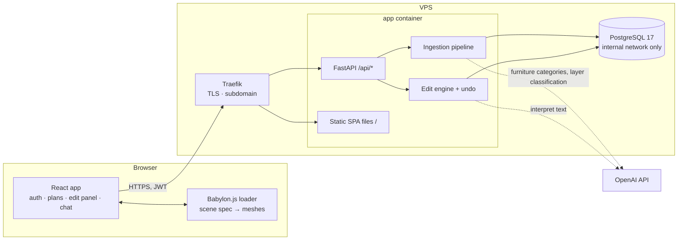
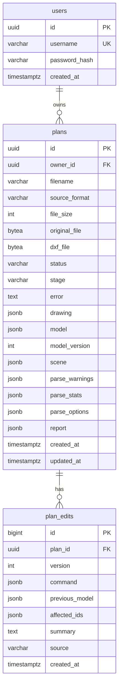

# Walkitecture — Architecture

> **Status (2026-11-07):** feature-complete MVP, live at **https://walkitecture.severyn.xyz**. Backend: pipeline,
> accounts, editing, LLM classification (§4.2) and review (§4.3), contracts, auth hardening (see
> [`backend/README.md`](backend/README.md)). Frontend: login/register, plan list + DWG upload, first-person/top-down
> walkthrough with GLB furniture, click-to-select, sliders, chat edits, undo, AI clean-up buttons (§7). Build order and
> remaining polish: [`IMPLEMENTATION_PLAN.md`](IMPLEMENTATION_PLAN.md).

## 1. Goals and non-goals

**Goal:** A logged-in user uploads a **DWG** floor plan. The server turns it into a semantic building model (walls,
doors, windows, rooms, furniture) and a render-ready Babylon.js scene spec, both stored in PostgreSQL. The browser
renders the spec as a walkable, first-person 3D scene. The user can change the building (window width, ceiling
height, …) with sliders or natural language **without reloading**.

**Non-goals (MVP):** photorealism, BIM/IFC export, building-code checks, LLM-generated geometry or code, PDF/image
uploads. (DXF uploads work too, but DWG is the product's input format.)

## 2. Decision log

| # | Decision | Choice | Why | Rejected alternatives |
| --- | --- | --- | --- | --- |
| D1 | How DWG is read | **LibreDWG 0.14 `dwg2dxf` → DXF → `ezdxf`**, compiled into the Docker image | ezdxf cannot parse DWG natively; `ezdxf.addons.odafc` (see `helper/read_dwg.py`) *also* converts to DXF under the hood. LibreDWG is open source, headless, and **reads both `/examples` DWGs correctly** (2018+ format) | ODA File Converter (proprietary, Qt + xvfb in Docker). Kept only as a fallback idea if a future DWG fails |
| D2 | What is stored per plan | Original upload, the converted DXF (cache, so re-parsing skips conversion), the **descriptive drawing JSON**, the **canonical building model**, and the **Babylon scene spec** | Every stage can be inspected and re-run; the DXF is an internal cache, never something the user has to provide | Re-converting the DWG on every re-parse |
| D3 | What the browser receives | **JSON only:** `{model, babylon}`. `model` = canonical building (source of truth for edits); `babylon` = render-ready boxes, glass panes, furniture placements, camera spawn, computed by the backend from `model`. One generic frontend loader turns the spec into meshes | No generated or stored code is ever executed in the browser; all geometry rules live in one tested Python module; the frontend stays thin | Generating Babylon.js *code* per DWG; computing wall sections in the frontend |
| D4 | LLM in ingestion | Rules first, LLM only for what rules cannot decide, and LLM output is always data validated by code. **Runs automatically on every upload, before the 3D model is built:** (1) classify layers/blocks from the drawing JSON inventory into parse options (§4.2); (2) category of unidentified furniture blocks; (3) one review pass: allowlisted patches for suspects + a decision per guardrail finding (§4.3, §4.4) | Raw drawings have thousands of entities — too big and noisy for an LLM to fix geometry directly. Names, counts, and sizes are small and are where an LLM adds most | LLM rewriting raw entity JSON; LLM placing geometry |
| D5 | Units & heights | **Meters.** All walls 10 ft = **3.048 m**; doors 0 → 7 ft (**2.134 m**); windows 2.5 → 6.5 ft (**0.762 → 1.981 m**) | Existing schema is metric; the UI can display feet | Storing feet |
| D6 | Furniture placement | **Rule-based:** match block → GLB by name (then footprint), size it from the drawing, align it to the INSERT's own axes, and turn its **back to the wall it stands against**; free-standing items face away from the nearest wall; **chairs near a table/desk face it**. LLM only names unknown blocks | DWG blocks have no shared "front" convention, so the wall rule is more reliable than trusting block rotation alone; rotation still gives the axes | Trusting the INSERT rotation as the facing; LLM placing furniture |
| D7 | Auth | **Username + password** (argon2id), **JWT bearer** tokens (HS256, 7 days, `JWT_SECRET`), `plans.owner_id` FK; every plan route scoped to the caller | Simple for a SPA; implemented | Session cookies (needs CSRF) |
| D8 | Hosting | **One app container** (FastAPI serves `/api/*` *and* the built SPA) + one PostgreSQL container, behind the VPS's existing **Traefik** on `walkitecture.severyn.xyz` | Same origin ⇒ no CORS, one image, one Traefik router | Separate frontend container (Nginx/Vite) |
| D9 | LLM provider | **OpenAI** (`OPENAI_MODEL`, default `gpt-5-mini`), structured outputs, rule-based fallback when no key | Implemented in `interpreter.py` and `furniture_llm.py` | Switching providers mid-hackathon |
| D10 | Where edits execute | **Server-authoritative.** Frontend sends an allowlisted edit command; backend validates, applies, stores an undo snapshot, and returns `{model, babylon, affectedIds, version}` | One validation path for sliders, chat, and LLM review; persistent undo | Client-side edits |
| D11 | What the 3D scene may never show | **Guardrails (§4.4):** code finds every violation and precomputes the possible fixes as validated edits; the AI only *chooses* among them (defaults without AI); a final deterministic pass enforces the hard rule (no furniture inside walls or other furniture), also after every manual edit. Corrections are stored in the building model, so re-rendering keeps them | The AI judges *which* mistake the drawing has; code guarantees the geometry. Nothing the AI says can produce an impossible scene | Free-form LLM geometry fixes; checking only in the frontend; asking the user to press "review" |
| D12 | Upload latency | **Background job** (`services/jobs.py`): the upload returns `status=processing` at once, the plan page shows the pipeline stage, and the job ends in `parsed` or `failed` (Retry: `POST /plans/{id}/process`). No DB transaction stays open during LLM calls; CPU-heavy steps run in worker processes | With three LLM calls at high reasoning effort a fresh drawing takes 1–4 minutes | Holding the upload request open for minutes; a separate queue service (overkill for one container) |
| D13 | The map's end | The scene spec closes the world: open **ground** to `MAP_MARGIN` (6 m) around the building, four solid **boundary** walls with the landscape photo (`map-end-background.jpg`, horizon at eye level) on their inner faces, and a **sky** canopy (`sky.avif`) on top. First person only; house walls and ceilings never use these materials. The viewer also respawns a walker who falls or leaves the map | Walking out of a door must never mean falling out of the world or seeing a void | Infinite ground plane (still a void at the horizon); skybox only (no collision) |

## 3. System overview



The browser downloads the SPA from the same origin it calls for `/api`, so there is no cross-origin traffic in
production. React and Babylon.js run in the user's browser; they reach the backend through Traefik like any client.

## 4. Ingestion pipeline (implemented)

```
upload ─► [1 convert] ─► DXF ─┬─► [2 describe]  ─► drawing JSON ─► [AI classify] ─► layer roles ─┐ (rebuild)
                              │        ▲ same classifier                                         │
                              └─► [3 build] ───► building model ─► [check] ─► findings ─► [AI review] ─► decisions
                                       └─ furniture: catalog match → LLM fallback → wall-rule placement     │
                                                                  [fix + enforce] ◄─────────────────────────┘
                                                                        └─► checked model ─► [4 scene] ─► Babylon spec
```

An upload (`POST /api/plans`) returns at once with `status=processing`; a background job (`services/jobs.py`) runs the
stages (`plans.stage`: `queued → converting → reading → classifying → rebuilding → furniture → checking → rendering →
reviewing → fixing → saving`) and stores every result through `services/plan_store.py`. `plans.status`: `uploaded → processing →
parsed | failed`. The orchestration is `services/pipeline.py`; CPU-heavy steps (describe + build, checks) run in worker
processes (`services/workers.py`, `PARSE_WORKERS`, `PARSE_TIMEOUT_S`) so a huge drawing can't freeze the server.
AI steps need `OPENAI_API_KEY`; any AI failure falls back to the rule-based result and the findings' defaults, and is
noted in the plan's `report`. `POST /plans/{id}/process` re-runs everything (Retry); `POST /plans/{id}/parse` re-runs
synchronously with explicit parse options and without the AI steps; the demo plan and the seed skip the AI steps.

| Stage | Module | Output |
| --- | --- | --- |
| 1 Convert | `services/dwg_convert.py` | Detects DWG/DXF by content; runs `dwg2dxf` with a timeout in a temp dir; DXF cached in `plans.dxf_file` |
| 2 Describe | `services/drawing_reader.py` (+ `classify.py`, `layers.py`) | **Descriptive drawing JSON** in `plans.drawing`: DXF version, units, extents, summary by category, layers (types + categories), blocks (insert count, category, entity types), and every model-space entity with raw geometry (drawing units), `category`, and the `reason` it was chosen |
| 3 Build | `services/dxf_parser.py` (+ `furniture_catalog.py`, `furniture_placement.py`, `furniture_llm.py`, `geometry.py`) | **Building model** in `plans.model`: walls (auto-detected centerline / double-line, multi-leaf walls merged, split walls re-joined, corners closed), openings snapped onto walls, rooms from outlines + text labels, furniture. Units checked against building size (both examples declare wrong units). Geometry outside the building outline is ignored |
| 4 Scene | `services/babylon_scene.py` | **Babylon scene spec** in `plans.scene`, regenerated after every edit |

Classification signals, strongest first (`classify.py`): block names in English and Spanish
(`door/puerta`, `window/ventana`, `bed/cama`, …; cryptic names count as doors only if the block contains a swing arc);
layer-name globs from settings (`WALL*`, `A-WALL*`, `MURO*`, `CARPINTERIA*`, `SUPERFICIE*`, `MUEBLE*`, …);
geometry (on mixed opening layers, a block with an arc is a door). Categories:
`wall | window | door | room | room_label | furniture | annotation | hatch | other`.

Inspect a drawing without the API: `backend/scripts/dwg_to_json.py <file.dwg>` writes the drawing JSON and prints the
classification summary.

Results on `/examples` (from `backend/README.md`): call center → 43 walls, 11 windows, 17 doors, 13 labelled rooms,
20 furniture models; apartment → 26 walls, 6 windows, 7 doors, 8 rooms, 17 furniture models.

### 4.1 Why keep JSON between DWG and Babylon.js

Going DWG → Babylon code directly would be quick to write once, but every misclassification would be invisible and
permanent. The JSON stages give us (a) a human-readable dump to debug a new drawing convention, (b) a small, structured
surface where an LLM can correct classification mistakes, (c) a stable model with IDs for live edits and undo, and
(d) a contract that lets frontend and backend work in parallel against fixtures.

### 4.2 LLM layer/block classification — implemented (`services/llm_classify.py`, `api/ai.py`)

Runs automatically for every upload (stage `classifying`): when the proposal differs from the rules, the drawing is
read again with it (stage `rebuilding`) and kept unless it loses most of the walls (< 30 % of the rules' count). The
roles used are stored in `plans.parse_options`. The endpoint below remains for API use; its UI button is hidden.

Input: the drawing JSON **without entities** (`GET /api/plans/{id}/drawing?entities=false`: layers, blocks, counts,
categories assigned by rules, a few sample texts). Output (structured): **parse options**, i.e. layer lists
(`wallLayers`, `windowLayers`, `doorLayers`, `roomLayers`, `furnitureLayers`, …) plus per-block category overrides,
with a confidence per item. `POST /api/plans/{id}/classify[?apply=true]` returns the proposal and, when applied,
re-runs the pipeline with those options. Because `ParseOptions` already accepts layer lists, the builder does not
change; block overrides are the only new parse option (`blockOverrides: {blockName: door|window|bed|…|ignore}`,
case-insensitive, checked before every other rule). Names not in the drawing and items below `minConfidence`
(default 0.5) are dropped and listed in `dropped`. The drawing JSON is stored even when building fails, so a plan with
`status=failed` ("no walls found") can still be classified.

### 4.3 LLM review pass — implemented (`services/reviewer.py`, `api/ai.py`)

1. Compute a **suspects list** deterministically: walls shorter than 0.3 m, walls with no connected endpoint, openings
   that failed to snap, furniture outside every room outline, rooms without a label, entries in
   `parseStats.unresolvedFurnitureBlocks`.
2. Send suspects + the guardrail **findings** with their options (§4.4) + parse warnings + stats (not the whole model)
   to the LLM. During upload this is one call (stage `reviewing`); it also returns one decision per finding.
3. The LLM returns patches from a **review allowlist**: `delete_wall {wallId}`, `merge_walls {wallIds}`,
   `set_opening_type {openingId, type}`, `delete_opening {openingId}`, `set_furniture_category {furnitureId, category}`,
   `delete_furniture {furnitureId}`, `rename_room {roomId, name}`.
4. Each patch runs through the **same edit engine** as UI edits (validation, undo snapshot, `plan_edits.source =
   "review"`). `POST /api/plans/{id}/review[?apply=true]` returns applied and rejected patches with reasons.
   Without `apply`, patches are validated in sequence on a copy (`status: valid | rejected`). Review operations are
   not accepted by `POST /edits`, so the UI allowlist stays small. No suspects means no LLM call. During upload the
   patches are applied before the model is first stored (no undo entries); the endpoint's UI button is hidden.

### 4.4 Guardrails: nothing impossible reaches the 3D scene — implemented (`services/guardrails.py`)

Code detects every violation and precomputes the possible fixes, each an allowlisted, validated edit; the AI picks one
option per finding with a reason (`report.findings[].decision / decidedBy / reason`); without AI the default applies. The
AI can choose, never invent geometry.

| Rule | Detection | Options (default **bold**) |
| --- | --- | --- |
| **Furniture never cuts into a wall** (doorways included) **or other furniture**; only a chair may sit up to 20 cm under a table/desk | Oriented footprints as rendered vs wall boxes as rendered (joint extensions included), separating-axis test, 1 cm tolerance | **accept** the gentle fix (move ≤ 35 cm and/or shrink to ≥ 85 %, cheapest clear spot; bigger, more important pieces keep their spot), remove this item, remove the other one. Moves under 3 cm are applied without asking |
| Furniture fits the drawing | `rendered_footprint`: the model fills the drawn outline exactly when its proportions allow (≤ 2.25× off), else keeps believable proportions inside the outline; never larger than drawn (a 7 ft bed is drawn 7 ft) | — |
| No window between two indoor spaces | Raster of the plan (10 cm cells): free areas = rooms; outdoors = connected to the drawing's border *and* open to the sky in ≥ 3 of 8 directions (so a building with a gap in its facade still has an inside) | turn it into a door, remove it, **keep** (glazed partition) |
| Every room has an entrance; the building has an exterior door | Room graph: rooms ≥ 1.5 m² and ≥ 0.6 m wide, joined by doors; components not reachable from the main part | turn a window on its boundary into a door, remove a 0.5–1.5 m wall closing it (a door leaf drawn on the wall layer), add a 0.8–0.9 m door on a shared wall (up to 3 candidates, circulation rooms first), **keep** (shaft, light well) |
| Furniture outside the building | Farther than 0.3 m outside the convex outline of the walls | **remove** (> 1.5 m from any wall: legend/library symbols), **keep** (closer: terrace) |
| No holes in the facade | A wall end in mid-air whose line reaches another wall (or a collinear piece) within 0.6–4 m, with the building's outline on one side only | **entrance** (wall + 0.9 m door), glazing, plain wall, keep open |
| No room misses a whole outer wall (open to the street) unless it is a balcony, terrace, veranda or yard | Two free wall ends 1–12 m apart whose connecting line runs along the building's outline and crosses no wall | **window** (a wall with a window 1.3x the building's typical window), door, plain wall, keep (**default** when the room is named balcony/terrace/patio…) |
| Furniture from contradictory contexts never shares a room | A free area (after the default seals) holding bathroom fixtures (toilet, shower, bathtub) and a kitchen unit/stove, kitchen sink, fridge, or living/sleeping furniture (washbasins are not modelled; kitchen + bed or sofa is fine) | remove the non-bathroom group or the bathroom group (**default** by the room's name, else the smaller group), keep (a wall between two rooms is missing) |
| A bathroom has doors or none, never a door plus a door-free connection (bathrooms only: other rooms may be open to each other) | Bathrooms found by their fixtures (toilet, shower, bathtub; labels are often printed beside the room); another room's label in the same free area; the hole whose closing separates them | **wall** (when the bathroom has a door), door, keep (only offered when it has no door) |

The parser feeds these checks better geometry first: a window or door filling the gap between a wall's end and
the next wall extends that wall; doors hang on the wall line through their swing arc's hinge and closed end (a
door block's square outline touches two walls); double-line pairs shorter than 0.3 m rank after long pairs and
count only when they cover most of both lines (tile grids drawn on the wall layer used to eat partitions); a
cryptic door-like name with an arc is not a door on a sanitary layer (shower trays).

### 4.5 Visual review — implemented (`services/plan_images.py`)

Before the review (stage `rendering`, in a worker process), two pictures are drawn at the same scale and crop
(the building + 0.6 m, 1600 px on the long side): the **original drawing** (every layer, grey levels on white,
via ezdxf + matplotlib) and the **model** built from it (walls grey, doors orange and windows blue with their IDs,
furniture footprints with ID, category and facing arrow, room names). They go into the same review call as the
suspects and findings (a vision model, `detail: high`), so it costs no extra call. The answer adds `rooms`: for
every room, what the drawing shows, what the model has, whether they match, and a note; mismatches are fixed with
the same allowlisted patches (IDs only; no new geometry except through finding options), and the pictures ground
the decisions on findings. The comparison is stored in `report.visual` and summarised in the plan's activity log.
If rendering fails, the review runs without pictures and a note says so.

`resolve` applies the review patches, then the chosen options, then `settle` (the furniture rule) on the result, so the
hard rule holds whatever was decided. A corrected item keeps its drawn footprint in `drawn`. The same `settle` runs after
every manual edit and scene replacement (a wall moved into a sofa pushes the sofa out, listed in `affectedIds`).
Everything is stored in the building model, so re-rendering keeps the corrections; `plans.report` (`PlanDetail.report`)
records the AI use, the classification summary, findings with decisions, changes, and notes, and the plan page shows a
summary in its activity log.

## 5. Canonical building model

Source of truth: `backend/app/schemas/building.py` (Pydantic, camelCase on the wire). All lengths in meters, plan
coordinates `(x, y)`.

```json
{
  "schemaVersion": 1,
  "units": "meters",
  "ceilingHeight": 3.048,
  "walls": [
    {
      "id": "wall_12", "start": [0, 0], "end": [5, 0], "thickness": 0.15, "height": 3.048,
      "openings": [
        { "id": "door_2",   "type": "door",   "offset": 0.4, "width": 0.91, "height": 2.134, "sillHeight": 0 },
        { "id": "window_3", "type": "window", "offset": 2.5, "width": 1.2,  "height": 1.219, "sillHeight": 0.762 }
      ]
    }
  ],
  "rooms": [
    { "id": "room_1", "name": "Call center 1", "polygon": [[0, 0], [5, 0], [5, 4], [0, 4]], "labelPosition": [2.5, 2] }
  ],
  "furniture": [
    {
      "id": "furniture_7", "category": "chair", "model": "chair_by_quaternius.glb",
      "sourceBlock": "SILLA", "matchedBy": "block_name",
      "position": [10.4, 6.2], "facing": [0, -1],
      "width": 0.6, "depth": 0.6, "height": 0.9
    }
  ]
}
```

| Field | Rule |
| --- | --- |
| `offset` | Distance along the wall from `start` to the opening's left edge |
| Heights (settings) | wall = ceiling = `10 ft`; door sill 0, height `7 ft`; window sill `2.5 ft`, height `4 ft` (top at 6.5 ft) |
| Furniture `category` | `bed`, `chair`, `sofa`, `desk`, `table`, `closet`, `toilet`, `bathtub`, `shower`, `sink` (kitchen sink counter), `kitchen` (counter/cabinet unit), `fridge`, `cabinet` (low or filing), `dresser`, `nightstand`, `bookshelf` (`schemas/parse.py FURNITURE_CATEGORIES`) |
| Furniture `model` | GLB file name from the catalog (`furniture_catalog.py`) |
| Furniture `matchedBy` | `block_name`, `layer`, `size`, `llm`, `manual` |
| Furniture `facing` | Unit vector (plan coordinates) the model's front points to |
| `width` / `depth` | Footprint across / along `facing`, from the drawing (or the corrected size, §4.4); `height` from the model's typical size |
| Furniture `drawn` | The footprint as drawn (`position`, `width`, `depth`) when the guardrails moved or resized the item, else absent |
| IDs | Stable across edits; regenerated only on re-parse |

When the model's shape changes incompatibly, bump `schemaVersion` and update the fixtures (see the implementation
plan).

## 6. Babylon scene spec

Source of truth: `backend/app/schemas/babylon.py`, generated by `services/babylon_scene.py`. Babylon world space,
meters, **y up; plan x → x, plan y → z**.

| Element | Spec |
| --- | --- |
| `meshes[]` | Boxes `{id, kind, wallId, openingId, position (center), size [along wall, height, thickness], rotationY}`; `kind ∈ wall, header, sill, glass, floor, ceiling, ground, boundary, sky` |
| Map end (D13) | `ground` box to `mapBounds` (+ under the walls), four `boundary` walls (10 m, solid, backdrop photo inside), one `sky` box on top. First person only |
| Walls | One height (10 ft). Split into `wall` boxes around openings; connected ends extended by half a thickness so corners close |
| Doors | Open from 0 to 7 ft; a `header` box of the wall's thickness from 7 ft to the wall top |
| Windows | Open from 2.5 to 6.5 ft; a `sill` box below, a `header` above, a thin `glass` pane in between |
| `openings[]` | Opening centers, sizes, and rotation (for picking and highlighting); single doors (≤ 1.2 m) carry a `leaf` |
| Door `leaf` | `{url, hinge, rotationY, swing, modelPosition, modelRotationY, scaling, size}`: the door GLB on a pivot at the hinge; `rotationY + swing` = open (88°). `services/doors.py` tries both jambs × both sides and keeps the swing that sweeps through no furniture or other wall; ties go to the hinge nearer a corner |
| `furniture[]` | `{id, category, model, url, position, rotationY, scaling, footprintCenter, footprint, facing}`; `url` is `/furniture/<file>`, served from `frontend/public/furniture/` |
| `rooms[]` | Label positions |
| `camera` | First-person spawn point at eye height (6 ft walker: 1.709 m), `bodyHeight`, plus a target |
| `materials` | Color + alpha per mesh `kind`; `texture` (image URL) for `boundary` (`/map-end-background.jpg`) and `sky` (`/sky.avif`) |
| `bounds` · `mapBounds` | Building extents · the walkable map (building + `MAP_MARGIN`) |

Furniture: the GLBs have inconsistent native scales and origins, so the catalog stores each model's measured native
size and center, and the spec always carries an explicit per-axis `scaling`. Each model's `front` (the side its seat,
doors or drawers face once loaded: `+z` for most; the corner shower `-z`, the filing cabinet `+x`) was checked by
rendering it; the spec turns that side toward `facing` (and swaps width/depth for sideways fronts). The frontend parents
the imported glTF `__root__` to a `TransformNode` and applies `position`, `rotationY`, and `scaling` to it.

## 7. Frontend

React 19 + TypeScript 5 + Vite, React Router, `@babylonjs/core` + `@babylonjs/loaders` (glTF). The frontend does **no
geometry reasoning**: it loads the backend's scene spec, builds meshes, handles input, and sends allowlisted edit
commands. The 3D pages are lazy-loaded so Babylon.js (~1.3 MB gzip) is not in the login/plan-list bundle.

```
frontend/
  vite.config.ts            dev proxy: /api → VITE_API_TARGET (default http://localhost:8000)
  public/furniture/         23 furniture GLBs + the door leaf → served at /furniture/*.glb
  public/map-end-background.jpg, public/sky.avif   backdrop and sky photos (D13)
  e2e/smoke.mjs             browser smoke test (puppeteer-core + local Chrome), see §12
  src/
    App.tsx                 routes: /login /register /plans /plans/:id /viewer; RequireAuth
    api/client.ts           fetch wrapper: JWT header, ApiError {status, code, message, problems}, 401 → logout
    api/endpoints.ts        one typed function per route used; api/schema.ts aliases over api/types.ts
    api/types.ts            generated from contracts/openapi.json (`npm run gen:types`)
    auth/                   AuthContext (token in localStorage, /me on start), AuthPage (login + register)
    plans/PlanListPage.tsx  plans (live stage while processing), DWG upload (button or drag & drop), sample, delete
    plans/PlanPage.tsx      processing screen → viewer + edit panel + chat; applies edit results, handles 409/422
    plans/Processing.tsx    pipeline stages while processing (polls GET /plans/{id}), error + Retry when failed
    edit/                   EditPanel (selection editor, ceiling + all-windows), ChatBox (activity log), AiPanel
    viewer/
      ViewerPage.tsx        canvas, HUD, crosshair, click-to-select, overlay slot; loads once per `loadKey`
      engine.ts             Viewer: load(spec, {keepCamera}), applyUpdate(spec, affectedIds), pick, select,
                            cameraForward; HighlightLayer selection; spawn faces the longest clear sightline
      registry.ts           objectId (wallId / furniture id / room id) → nodes, for partial rebuilds
      load/boxes.ts         spec.meshes → boxes; collisions on wall/header/sill/glass/floor/ground/boundary
      load/materials.ts     shared per-kind materials; photo materials for boundary walls (horizon at eye level) and sky
      load/furniture.ts     one AssetContainer per GLB, instances under a TransformNode, invisible footprint colliders
      load/doors.ts         door leaves on hinge pivots (animated open/close, moving collider), invisible doorway targets
      load/labels.ts        billboard room names
      cameras.ts            first-person UniversalCamera (WASD/arrows, pointer lock, gravity) ⇄ top-down ArcRotate
      fixtures.ts           contracts/fixtures/*.scene.json as lazy chunks for /viewer?fixture=<name>[&view=top]
```

Behaviour:
- **Loading:** a fresh load spawns at `spec.camera` facing the most open direction. Edits, undo, and AI fixes call
  `applyUpdate` / `load(…, {keepCamera: true})`, so the walkthrough continues from the same spot.
- **`applyUpdate`:** disposes and recreates only the meshes of walls / furniture in `affectedIds` (an affected opening
  rebuilds its wall); `"building"` (e.g. ceiling height) rebuilds everything but keeps the camera.
- **Selection:** in first person (pointer locked) a click picks what is under the crosshair; in top-down, under the
  pointer. Openings select by `openingId`, walls by `wallId`, furniture by id (its footprint box is shown, because GLB
  instances can't be outlined). Floor/ceiling clear the selection.
- **Edits:** sliders and buttons send `POST /edits` with `baseVersion`; chat sends `POST /interpret-edit` with
  `selectedId`, `cameraForward` (plan x/y of the view direction) and `apply=true`. `409 version_conflict` reloads the
  scene, `409 nothing_to_undo` and `422 problems` are shown in the activity log.
- **Processing:** after an upload the plan page shows the pipeline stages until the plan is `parsed` (then the scene
  loads and the activity log lists what the automatic checks changed) or `failed` (error + Retry).
- **AI panel:** hidden (`SHOW_AI_TOOLS = false` in `PlanPage.tsx`): classification and review run on every upload. The
  component and the `/review`, `/classify` endpoints are kept.
- **Doors:** single doors start closed. In first person, a door (or open doorway) under the crosshair within 2.5 m
  shows "Press E to open/close the door"; E swings it on its hinge (0.45 s). Its collider moves with it, so a closed
  door blocks the walker. Open doors stay open across edits.
- **Map end:** ground, backdrop walls and sky are shown only in first person (top-down keeps the blueprint background);
  if the walker ever falls below the floor or leaves `mapBounds`, it is put back at the spawn point.
- First-person body: ellipsoid radius 0.3 m, 6 ft tall, eye height from `spec.camera.eyeHeight` (1.709 m), gravity on; GLB meshes
  don't collide, their footprint boxes do. Shared materials per `kind`, `freezeWorldMatrix()` on static meshes.

## 8. Backend

### 8.1 Module map

```
backend/app/
  main.py, spa.py         app factory, CORS (dev only), routers, production checks; spa.py serves STATIC_DIR
  config.py               settings: DB, JWT, seed, LibreDWG, OpenAI, layer patterns, height defaults
  db.py, models.py        async engine; users, plans, plan_edits
  api/
    auth.py               register, login, token (Swagger form), me
    deps.py               SessionDep, SettingsDep, CurrentUser
    plans.py              upload, demo, list/get/delete, parse, drawing, scene, file
    edits.py, interpret.py, ai.py (classify, review), health.py, errors.py
  schemas/                building, babylon, edits, parse, api
  services/
    dwg_convert.py        format detection + LibreDWG
    drawing_reader.py     DXF → drawing JSON
    classify.py, layers.py  classification rules
    dxf_parser.py         DXF → building model
    furniture_catalog.py, furniture_placement.py, furniture_llm.py, glb_bounds.py
    babylon_scene.py      model → scene spec (walls, openings, furniture, map end)
    doors.py              door leaves: hinge side and swing that clear furniture
    edits.py, geometry.py allowlisted edits + validation
    interpreter.py        OpenAI + rule-based edit interpretation
    pipeline.py           §4 orchestration: read → AI classify → furniture → checks → AI review → fix
    guardrails.py         §4.4 findings with options, decisions, the furniture rule (`settle`)
    jobs.py               background processing of uploads, stages, interrupted-job recovery
    workers.py            CPU-heavy steps in worker processes with a time limit
    plan_store.py         pipeline persistence, ownership, history, undo, optimistic versions
    auth.py               argon2id + JWT
    seed.py               idempotent dev account + sample plans
    llm.py                shared OpenAI client + structured calls (LLMUnavailable -> 503)
    llm_classify.py       §4.2 layer/block classification
    reviewer.py           §4.3 suspects + review patches + decisions on findings
    rate_limit.py         per-IP sliding window for login/register
    contracts.py          OpenAPI + scene fixtures for the frontend
  scripts/                dwg_to_json.py, seed.py, make_sample_dxf.py, export_openapi.py, export_fixtures.py
```

### 8.2 API

All `/api/plans*` and `/api/interpret-edit` routes require `Authorization: Bearer <jwt>`. A plan that belongs to
another user is treated as not found.

| Method & path | Purpose | Status |
| --- | --- | --- |
| `POST /api/auth/register` · `POST /api/auth/login` | `{username, password}` → `{accessToken, tokenType, expiresIn, user}` | done |
| `POST /api/auth/token` · `GET /api/auth/me` | OAuth2 form login (Swagger "Authorize") · current user | done |
| `GET /api/health` | DB status, `dwg2dxf` availability, active interpreter (public) | done |
| `POST /api/plans` | Upload `.dwg` (or `.dxf`); returns `status=processing` and processes it in the background (`?parse=false` to only store) | done |
| `POST /api/plans/{id}/process` | Process again from scratch like an upload (Retry); `409 plan_processing` while running | done |
| `POST /api/plans/demo` | Built-in sample apartment for the caller | done |
| `GET /api/plans` · `GET/DELETE /api/plans/{id}` | Own plans | done |
| `POST /api/plans/{id}/parse` | Re-run now with explicit parse options (no AI steps, guardrails apply); clears edit history | done |
| `GET /api/plans/{id}/drawing[?entities=false]` | Descriptive drawing JSON | done |
| `GET /api/plans/{id}/scene` · `PUT …` | `{planId, version, model, babylon}` · replace the model (validated, undoable) | done |
| `GET /api/plans/{id}/file?kind=original\|dxf` | Download the upload or the converted DXF | done |
| `POST /api/plans/{id}/edits[?dryRun=true]` · `GET …` | Apply/preview one allowlisted edit · history | done |
| `POST /api/plans/{id}/undo` | Revert the latest edit | done |
| `POST /api/interpret-edit` | Text + `selectedId` + `planId` → typed command, validation, optional apply | done |
| `POST /api/plans/{id}/classify[?apply=true]` | LLM layer/block classification → parse options (§4.2) | done |
| `POST /api/plans/{id}/review[?apply=true]` | LLM review patches (§4.3) | done |

Edit allowlist: `resize_selected_window`, `resize_windows`, `set_ceiling_height` (2.1–6.0 m), `move_selected_wall`
(free-standing walls). Edit responses include `affectedIds`, the new `version`, `model`, and `babylon`. Sending
`baseVersion` returns `409` on conflicts. Rejected edits return `422` with machine-readable `problems`.

### 8.3 Auth

- Usernames 3–64 chars (`[A-Za-z0-9_.@-]`), stored lower-case; passwords 8–128 chars, hashed with argon2id. Login
  verifies against a dummy hash for unknown users so timing doesn't reveal which accounts exist.
- JWT HS256, claims `sub` (user id), `iat`, `exp` (default 7 days, `JWT_EXPIRE_MINUTES`), no refresh tokens.
  Without `JWT_SECRET` the backend uses a random per-process secret, so tokens die on restart. **Production must set
  it.**
- `CurrentUser` dependency in `api/deps.py`; `plan_store.get_plan(session, plan_id, owner_id)` enforces ownership.
- Register returns a token right away. The frontend keeps the token in `localStorage`, which is acceptable for the
  MVP because the app never renders user-supplied HTML.
- Rate limits: `LOGIN_RATE_LIMIT` (10) and `REGISTER_RATE_LIMIT` (5) attempts per minute per client IP → `429`
  with `Retry-After` (`/login` and `/token` share a bucket). In-process, which is fine for the single app container.
- `APP_ENV=production` refuses to start without a `JWT_SECRET` of ≥ 32 characters or with the default seed password.
- Dev seed (`scripts/seed.py`, run on container start): account `demo` / `walkitecture-demo` owning the sample
  apartment and both `/examples` drawings. **Disable in production** with `SEED_USERNAME=` (empty) or set strong
  credentials.

### 8.4 Data model (PostgreSQL 17)



Migrations (Alembic, run on container start): `0001_initial`, `0002_users_drawing_scene` (users, `plans.owner_id`,
`drawing`, `scene`), `0003_processing_checks` (`plans.stage`, `parse_options`, `report`). Plans created before 0002
have no owner and are invisible. New migrations continue from `0003_processing_checks`; if two PRs add one in parallel, the second adds an `alembic merge heads` revision.
`plan_edits.source` values: `api | ui | openai | rules | review`.

## 9. Deployment

Live at **https://walkitecture.severyn.xyz** (VPS stack in `/opt/stacks/walkitecture`, Traefik network `web`).

### 9.1 Image

One root `Dockerfile` (compose build context = repo root):

1. `libredwg` stage — builds `dwg2dxf`.
2. `frontend` stage — `node:22-alpine`, `npm ci && npm run build` → `/web/dist` (includes `public/furniture/*.glb`).
3. `runtime` stage — Python 3.12 + uv + LibreDWG + `backend/` + `COPY --from=frontend /web/dist /app/static`.

With `STATIC_DIR` set (the image sets `/app/static`), `app/spa.py` serves real files from it (hashed `/assets/*`
cached as immutable) and `index.html` for any other non-API GET (client-side routing). Unknown `/api/*` paths keep
the JSON 404. Without `STATIC_DIR` (local `uvicorn`), `/` redirects to `/docs`. Runs as non-root user `app`;
startup = migrate → seed (if enabled) → uvicorn with `--proxy-headers --forwarded-allow-ips '*'`.

### 9.2 Compose

- `docker-compose.yml` — local dev: `db` on `localhost:5433`, `backend` on `:8000`, `/examples` mounted for the seed
  (dev seed defaults `demo` / `walkitecture-demo`). Frontend dev runs on the host: `cd frontend && npm run dev`
  (Vite, hot reload, proxies `/api` to `:8000`).
- `docker-compose.prod.yml` — VPS override: no published ports, `POSTGRES_PASSWORD` / `JWT_SECRET` / `APP_DOMAIN`
  required (compose fails fast without them), seeding **off unless `SEED_USERNAME` and `SEED_PASSWORD` are set in
  `.env`**, backend joins the external Traefik network (`TRAEFIK_NETWORK`, default `web`) with router labels for
  `Host(${APP_DOMAIN})`, entrypoint `websecure`, certresolver `letsencrypt`.

Deploy / update on the VPS:

```bash
cd /opt/stacks/walkitecture && git pull --ff-only
docker compose -f docker-compose.yml -f docker-compose.prod.yml up -d --build
```

`APP_ENV=production` (set by the prod override) makes the app refuse to start without a `JWT_SECRET` of ≥ 32
characters or with the default seed password; login/register are rate-limited per client IP (real IPs thanks to
`--forwarded-allow-ips`, safe because only Traefik can reach the container).

### 9.3 Environment variables

| Variable | Used by | Notes |
| --- | --- | --- |
| `POSTGRES_USER/PASSWORD/DB` | db, backend | strong password in production |
| `JWT_SECRET`, `JWT_EXPIRE_MINUTES` | backend | secret required in production (`openssl rand -hex 32`) |
| `SEED_USERNAME`, `SEED_PASSWORD`, `SEED_SAMPLE_PLANS` | backend | dev defaults `demo` / `walkitecture-demo`; empty username disables |
| `OPENAI_API_KEY`, `OPENAI_MODEL` | backend | optional; rules-only without a key |
| `OPENAI_REASONING_EFFORT`, `OPENAI_TIMEOUT_S`, `OPENAI_MAX_RETRIES` | backend | default `high`, 300 s, 1 retry. Measured whole-plan classify on the apartment example: `high` 67–74 s, `medium` (model default) ~35 s, `low` ~22 s, `minimal` ~15 s. The old 30 s timeout made `medium` fail with `APITimeoutError` |
| `MAX_UPLOAD_MB` | backend | default 25 |
| `PROCESS_IN_BACKGROUND` | backend | default `true`: uploads return at once and are processed by a background job (tests set `false`) |
| `PARSE_WORKERS`, `PARSE_TIMEOUT_S` | backend | worker processes for CPU-heavy steps (default 2) and the time limit per step (300 s), after which the drawing fails as "too complex" instead of freezing the server |
| `APP_ENV` | backend | `production` (set by the prod override) enables the startup checks |
| `LOGIN_RATE_LIMIT`, `REGISTER_RATE_LIMIT` | backend | per-IP attempts per minute (0 disables) |
| `*_LAYERS` | backend | layer-name globs (see `backend/.env.example`) |
| `APP_DOMAIN`, `TRAEFIK_NETWORK`, `TRAEFIK_ENTRYPOINT`, `TRAEFIK_CERTRESOLVER` | prod compose | `walkitecture.severyn.xyz`, `web`, `websecure`, `letsencrypt` on our VPS |

## 10. Security notes

- Uploaded drawings are untrusted input to a C converter: size limit, timeout, temp dir per request, non-root
  container.
- LLM output is **data**: always parsed against a schema and executed only through allowlisted, validated operations.
  No stored or generated code is executed in the browser.
- Ownership is enforced in one place (`plan_store.get_plan` with the caller's id).
- Secrets only via environment / git-ignored `.env`; Postgres is not reachable from the internet; the default seed
  credentials must never reach a public deployment.

## 11. Error handling

| Situation | Behaviour |
| --- | --- |
| Not a DWG/DXF / too large | `415` / `413`, nothing stored |
| Converter fails or times out | plan saved with `status=failed` and an `error` message; re-parse or delete |
| No walls found | fallback: layer `0` linework when wall layers are sparse; warning; `failed` if still empty |
| Furniture block not identified | LLM category if a key is set, otherwise listed in `parseStats.unresolvedFurnitureBlocks` |
| LLM unavailable | rules only; edits use the rule-based interpreter; classify/review return `503 llm_unavailable` |
| Invalid edit | `422` with `problems[]`; model unchanged |
| Version conflict | `409`; frontend refetches the scene |

## 12. Testing

- **Backend (exists):** parser, edits, interpreter, furniture (every catalog model lands on its footprint front-first in
  all four directions), scene, doors, guardrails/pipeline/background job (`test_checks.py`, fake LLM), auth, seed,
  and API tests (`uv run pytest`).
  API tests need the compose database; the `/examples` end-to-end tests need `dwg2dxf` and run inside the image.
- **Contract:** `tests/test_contracts.py` fails when `contracts/openapi.json` is stale, validates every
  `contracts/fixtures/*.scene.json` against `SceneResponse`, and checks the orientation fixture's semantics (plan
  y → z, glTF +z front, chair faces table); the frontend type-checks against the generated types.
- **Frontend:** `npm run build` type-checks against the generated contract types.
- **Browser smoke test:** `cd frontend && npm run e2e -- <baseUrl> [dwgFile]` (puppeteer-core driving the local
  Chrome): login redirect → register → sample plan → click a window in 3D → +50% → undo → look at a door, its hint
  appears, E opens and closes it → chat ceiling edit → AI panel hidden → (optional) upload a DWG, follow the processing
  stages, walk it, check the map end and the respawn guard → plan list → logout → public sample viewer → the
  `furniture-library` fixture loads and places every GLB. Fails on any step, 5xx, or page error. Needs a
  dev build (`npm run dev`) or a production URL; against production it registers a throwaway `e2e_*` account.
