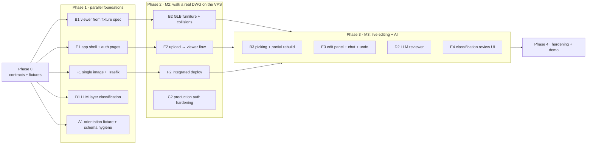

# Walkitecture — Implementation Plan

Companion to [`ARCHITECTURE.md`](ARCHITECTURE.md) (section numbers like §4.2 refer to it). The plan is split into
**phases** (sync points) and **tracks** (parallel work streams). Within a phase every track works independently
because tracks only touch their own directories and talk to each other through **contracts** (schemas + fixtures).

## Where we are (2026-11-07: MVP complete, live at https://walkitecture.severyn.xyz)

| Area | Status |
| --- | --- |
| DWG → DXF (LibreDWG) → descriptive drawing JSON → building model → Babylon scene spec | ✅ done, both `/examples` DWGs parse |
| Heights (10 ft walls, 7 ft doors, 2.5–6.5 ft windows), headers/sills/glass | ✅ done (in the scene spec) |
| Furniture: catalog match, wall-rule placement, LLM category fallback | ✅ done |
| Accounts: register/login/me, JWT, plan ownership, dev seed | ✅ done |
| Edits, undo, natural-language interpretation | ✅ done |
| Inspection script (`backend/scripts/dwg_to_json.py`) | ✅ done |
| Contracts: `contracts/openapi.json`, generated `frontend/src/api/types.ts`, `export_openapi.py`, `export_fixtures.py`, `test_contracts.py` | ✅ done (Phase 0.1–0.2) |
| Fixtures: demo apartment, both DWG examples, orientation check (A1) | ✅ done (Phase 0.3, A1) |
| GLBs in `frontend/public/furniture/` (served at `/furniture/`) | ✅ done (Phase 0.4) |
| Single image (SPA + API) + Traefik on https://walkitecture.severyn.xyz | ✅ done (F1) |
| Viewer: walls, openings, glass, labels, GLB furniture, footprint colliders, first-person + top-down, spawn facing open space; public `/viewer?fixture=<name>[&view=top]` | ✅ done (B1, B2) |
| App shell: routing, login/register, plan list, DWG upload (button + drag & drop), sample plan, delete (E1, E2) | ✅ done |
| LLM layer classification (D1, §4.2), auth hardening (C2) | ✅ done (backend) |
| LLM review (D2, §4.3) + AI panel (Review plan / Re-classify layers) | ✅ done (needs `OPENAI_API_KEY` on the server) |
| Picking + highlight, partial rebuild by `affectedIds`, edit panel (window width, ceiling, all windows, move wall), chat, undo (B3, E3) | ✅ done |
| Browser smoke test `frontend/e2e/smoke.mjs` (`npm run e2e -- <url> [dwg]`) | ✅ passes locally and on production |
| Large drawings: grid-indexed parser (44k-entity flat in 5 s, was ~200 s), CPU work in worker processes with a time limit | ✅ done (the site no longer freezes on a big upload) |
| Automatic checks before 3D (§4.4): AI classification + review on every upload, guardrails (furniture vs walls/furniture, interior windows, rooms without entrance, stray furniture), enforcement after every edit; background processing with stages + Retry; AI panel hidden | ✅ done |
| Map end (D13): ground, backdrop walls, sky, respawn guard | ✅ done |
| Furniture library: 23 models / 16 categories (kitchen, bathroom, storage, office chair, armchair…), per-model front; interactive single doors (E) | ✅ done |
| Remaining polish (Phase 4): per-layer classification review screen (E4), CI (F3), double doors, closing open gaps in facades | ⬜ optional |

## Tracks and ownership

| Track | Scope | Owns (directories / files) |
| --- | --- | --- |
| **A — Ingestion** | parser/classifier quality, scene spec, schema changes, contracts export | `backend/app/services/{dwg_convert,drawing_reader,classify,layers,dxf_parser,furniture_*,babylon_scene}.py`, `backend/app/schemas/{building,babylon,parse}.py`, `backend/scripts/`, `contracts/` |
| **B — 3D Viewer** | spec loader, cameras, collisions, furniture GLBs, picking, partial rebuild | `frontend/src/viewer/`, `frontend/public/furniture/` |
| **C — Accounts** | auth upkeep, production hardening of auth/seed | `backend/app/api/{auth,deps}.py`, `backend/app/services/{auth,seed}.py` |
| **D — AI** | LLM layer classification, reviewer, interpreter upkeep | `backend/app/services/{llm_classify,reviewer,interpreter,furniture_llm}.py`, their schemas |
| **E — App shell & Edit UI** | routing, API client, auth pages, plan list/upload, edit panel, chat, undo | `frontend/src/{api,auth,plans,edit}/`, `frontend/src/App.tsx` |
| **F — Platform** | root Dockerfile, SPA serving, compose files, Traefik, VPS, CI | `Dockerfile`, `docker-compose*.yml`, static mount in `backend/app/main.py`, `.github/` |

Tracks A and C are mostly done, so their owners can pick up D or F. With fewer people: **A+C+D** (backend),
**B+E** (frontend), **F** (whoever owns the VPS).

Shared files that need a heads-up before changing: `contracts/**`, `backend/app/config.py`, `backend/app/models.py`,
`backend/alembic/versions/`, `backend/app/api/plans.py`, `frontend/package.json`.

## Phase map

Rough timing: Phase 0 ≈ 1 h · Phase 1 ≈ 3 h · Phase 2 ≈ 2–3 h · Phase 3 ≈ 3 h · Phase 4 ≈ 1–2 h.

---

## Phase 0 — Contracts and fixtures (≈ 1 h, A + B + E)

Goal: the frontend can be built entirely against files on disk, with no running backend.

| ID | Task | Track | Done when |
| --- | --- | --- | --- |
| 0.1 | **OpenAPI export:** `backend/scripts/export_openapi.py` writes `contracts/openapi.json` from `app.openapi()` (covers auth, plans, scene, edits, interpret, `Building`, `BabylonScene`) | A | File committed |
| 0.2 | **TS types:** `frontend` scaffold (Vite React TS) with `npm run gen:types` → `src/api/types.ts` via `openapi-typescript contracts/openapi.json` | E | Types compile |
| 0.3 | **Fixtures:** `backend/scripts/export_fixtures.py` saves `GET /scene` responses of the seeded plans to `contracts/fixtures/{demo-apartment,call-center-offices,apartments-140202}.scene.json` (run inside the image so the DWGs convert) | A | Three fixtures committed; a pytest validates them against `SceneResponse` |
| 0.4 | **GLBs:** move `frontend/furniture/*.glb` → `frontend/public/furniture/` (the spec's `url` is `/furniture/<file>`); update `furniture_catalog.py` / `glb_bounds.py` paths | A + B | Backend tests pass; Vite serves `/furniture/chair_by_quaternius.glb` |
| 0.5 | Repo hygiene: extend root `.gitignore` (`node_modules/`, `dist/`, `frontend/.vite/`), root `.env.example` with all §9.3 variables, branch naming `track-<letter>/<topic>` | F | Merged |

**Exit:** contracts + fixtures on `main`. From here on, any change to `building.py`, `babylon.py`, or `api.py` must
re-run 0.1 and 0.3 and regenerate types **in the same PR**.

---

## Phase 1 — Parallel foundations (≈ 3 h)

### B1 — Viewer from a fixture spec (Track B)
- `viewer/engine.ts`, `registry.ts`, `load/boxes.ts` (spec `meshes` + `materials`), `load/labels.ts`,
  `load/index.ts` (`loadScene`), `cameras.ts` (first-person from `spec.camera`, WASD + pointer lock, collisions,
  gravity; top-down toggle on `T`).
- `?fixture=call-center-offices` loads `contracts/fixtures/*.scene.json` — **no backend needed**.
- **Done:** walk through the call-center fixture; walls block you, doors don't; windows are see-through; top-down view
  shows the whole plan un-mirrored.

### E1 — App shell and auth pages (Track E)
- `api/client.ts` (base URL, JWT header, `ApiError` from `{error: {code, message, problems}}`, 401 → logout),
  `auth/AuthContext`, `LoginPage`, `RegisterPage` (`{username, password}` → `accessToken`), routing (`/login`,
  `/register`, `/plans`, `/plans/:id`), `PlanListPage`, `UploadDialog` (`.dwg`).
- Works against the real backend from the start (`docker compose up`, dev proxy), log in as the seeded `demo` user.
- **Done:** register → login → plan list shows the three seeded plans → upload dialog posts a DWG.

### F1 — Single image and Traefik (Track F)
- Root `Dockerfile` (libredwg → frontend build → runtime, §9.1); compose build context → repo root.
- `main.py`: serve `STATIC_DIR` + `index.html` fallback for non-`/api` paths; keep `/docs`.
- `docker-compose.prod.yml` (§9.2) with seed off and `JWT_SECRET` required; uvicorn `--forwarded-allow-ips='*'`.
- **Done:** `https://<APP_DOMAIN>/` serves the (placeholder) SPA, `https://<APP_DOMAIN>/api/health` is OK over TLS,
  Postgres has no public port, `demo` login does **not** exist on the VPS.

### D1 — LLM layer/block classification (Track D, §4.2)
- `services/llm_classify.py`: drawing JSON without entities → structured proposal (layer lists + block category
  overrides + confidence), reusing the OpenAI client pattern from `interpreter.py`.
- New parse option `blockOverrides: {blockName: category}` honoured by `classify.py` (coordinate with A).
- `POST /api/plans/{id}/classify[?apply=true]`.
- **Done:** on a copy of a sample with renamed layers (e.g. `MUROS` → `XYZ-1`), the LLM proposal restores a walkable
  model; tests with a mocked LLM; rules-only path unchanged.

### A1 — Orientation fixture and schema hygiene (Track A)
- `contracts/fixtures/orientation.scene.json`: an asymmetric L-shaped room, one door, one window, one chair against a
  wall and one table + chair pair (verifies plan y → z, glTF +z front, chair-faces-table).
- Decide whether furniture/scene changes need `schemaVersion` bumps and document it in ARCHITECTURE.md §5.
- **Done:** fixture committed; B confirms it renders as expected.

---

## Phase 2 — Milestone M2: "walk a real DWG on the VPS" (≈ 2–3 h)

| ID | Task | Track | Depends on | Done when |
| --- | --- | --- | --- | --- |
| B2 | **Furniture + colliders:** `load/furniture.ts` (AssetContainer cache per `url`, `TransformNode` with `position`/`rotationY`/`scaling`, instances), invisible collider boxes from `footprintCenter` + `footprint` | B | B1, 0.4 | Orientation fixture: chair backs to walls, chairs face tables; you cannot walk through desks |
| E2 | **Upload → viewer flow:** upload with progress, `status` + `parseWarnings`, open `/plans/:id` with B's `ViewerPage`; error states (`413`, `415`, `failed`) | E | E1, B1 | Logged-in user uploads `call-center-offices.dwg` and lands in the walkthrough |
| F2 | **Integrated deploy** of frontend + backend to the VPS; create the team's accounts there | F | F1, E2 | M2 works on the subdomain |
| C2 | **Auth hardening for prod:** rate-limit or slow down `/login` + `/register` (simple in-process limiter is fine), refuse to start in prod mode without `JWT_SECRET`, document account creation on the VPS | C | — | Tests for the limiter; prod compose fails fast without the secret |

**Milestone M2:** on the VPS, a registered user uploads `examples/call-center-offices.dwg` and walks through it, with
furniture, in first person and top-down.

**Integration point:** B2 and E2 meet only in `ViewerPage.tsx` — B owns the canvas, E owns the overlays.

---

## Phase 3 — Milestone M3: live editing and AI (≈ 3 h)

| ID | Task | Track | Done when |
| --- | --- | --- | --- |
| B3 | **Picking + partial rebuild:** click to select a wall/window/door/furniture (HighlightLayer), expose `selectedId`; `applyUpdate(scene, spec, affectedIds)` recreates only affected meshes and colliders; push the camera out if a new collider traps it | B | Widening a window rebuilds one wall's meshes; camera position unchanged |
| E3 | **Edit UI:** sliders (selected window width, ceiling height) → `POST /edits` with `baseVersion`; `ChatBox` → `POST /interpret-edit` with `selectedId`, `apply=true`; Undo button; show `422 problems`; on `409` refetch the scene | E | README demo scenario steps 3–6 work in the browser |
| D2 | **Reviewer (§4.3):** suspects list, OpenAI patch proposals, review-only operations in `edits.py`, `POST /api/plans/{id}/review[?apply=true]`, `source="review"` | D | On the call-center plan the reviewer fixes at least one real issue; every patch is undoable |
| E4 | *(optional)* **Classification review screen:** layers and blocks from `GET /drawing?entities=false` with category dropdowns → `POST /parse` with layer lists / `blockOverrides`; button for D1's `/classify` proposal | E | A human can fix classification without the LLM |
| F3 | **CI:** GitHub Actions running `ruff`, `pytest` (Postgres service), `npm run build`, type-check against `contracts/openapi.json` | F | Green on `main` |

**Milestone M3:** the full demo scenario from `README.md`, on the VPS.

---

## Phase 4 — Hardening and demo (≈ 1–2 h)

- Performance pass on the call-center plan (frame rate in first person; freeze static meshes; furniture instances).
- Collisions at door jambs; spawn point inside a large room.
- Run the `/examples` end-to-end tests inside the image (`docker compose run --rm backend uv run pytest`).
- Demo script + fallback: a demo account on the VPS with pre-parsed plans; sliders if OpenAI is slow.
- Final README/ARCHITECTURE pass; database backup command on the VPS (`docker compose exec db pg_dump …`).

---

## Working agreements

- **Branches:** `track-<letter>/<topic>`, small PRs to `main`, rebase often.
- **Contracts first:** a schema change ⇒ update the Pydantic model, re-export `contracts/openapi.json` and fixtures,
  regenerate TS types — one PR.
- **Migrations:** continue from `0002_users_drawing_scene`; if `alembic heads` shows two heads, the second PR adds a
  merge revision.
- **Fixtures over waiting:** a track blocked on another uses fixtures instead of waiting.
- **Definition of done:** tests for new backend logic, `ruff check` clean, frontend builds, and the current milestone
  checklist still works.
