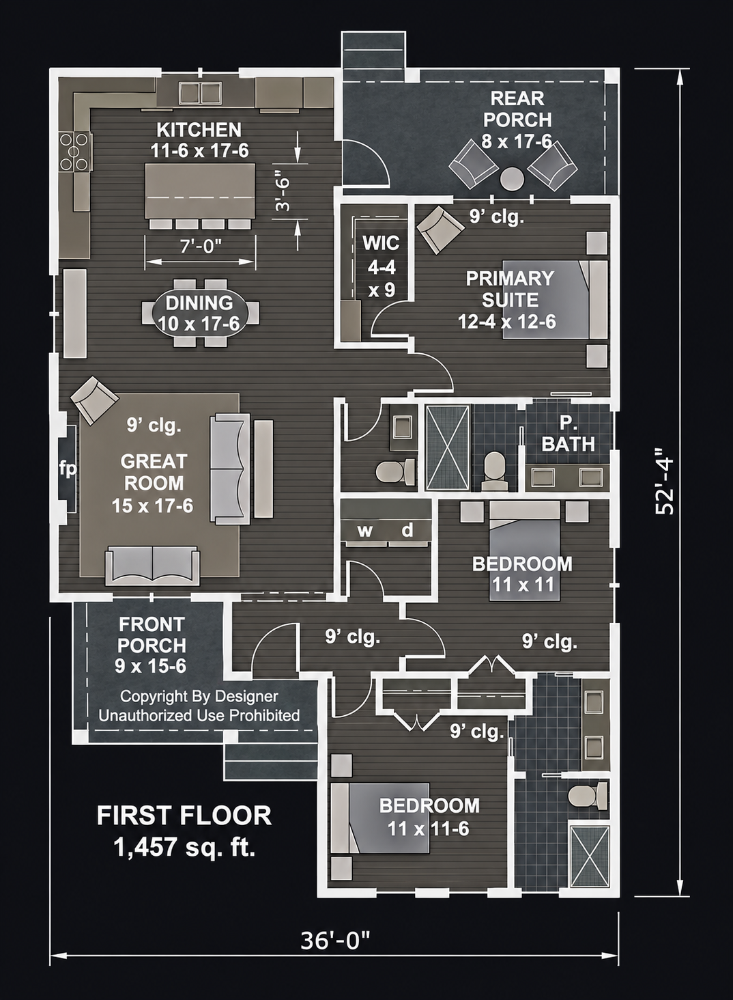
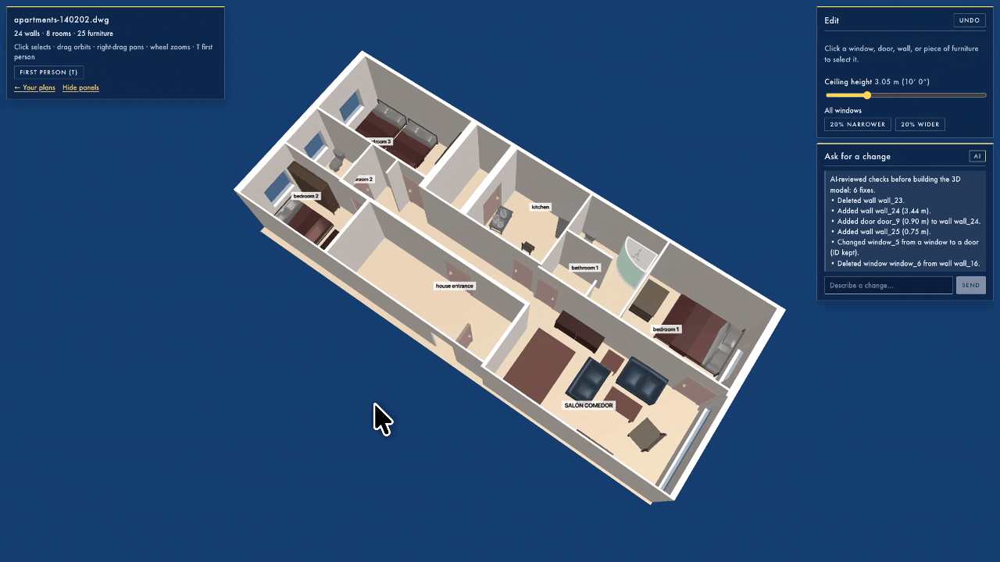
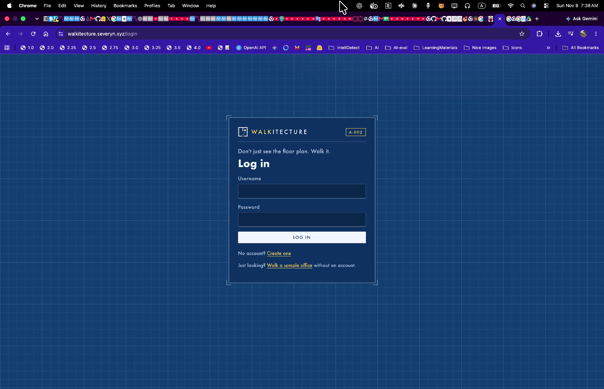
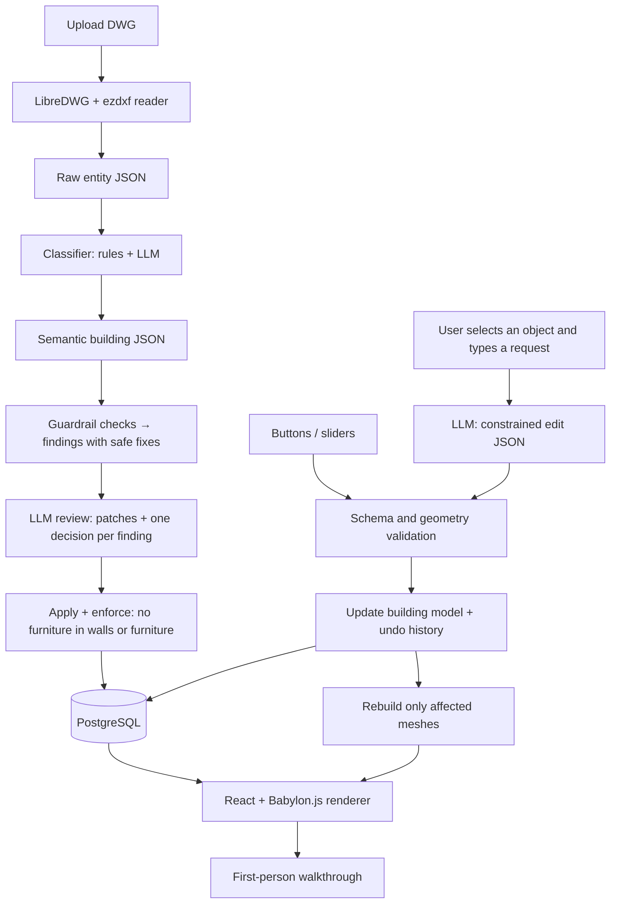

# Walkitecture 🏠🎮

**Don't just see the floor plan. Walk it.**

<p align="center">
  
</p>

<h3 align="center">⬇️ Walkitecture turns a floor plan into a space you can walk ⬇️</h3>

**First-person walkthrough** — approach the building from outside, open doors with E, and walk through the bedrooms,
hallway, and living room at human scale.


**Top-down view** — press T to see the whole layout from above, with labeled rooms, furniture, doors, and windows.



> **Hackathon project · One-day MVP · Work in progress.** Built for **Capitol Hacks 5.0** at the Carlsen Center,
> Sacramento State University.
>
> Design: [`ARCHITECTURE.md`](ARCHITECTURE.md) · Build order: [`IMPLEMENTATION_PLAN.md`](IMPLEMENTATION_PLAN.md) ·
> Backend details: [`backend/README.md`](backend/README.md)

**Walkitecture** turns an architectural **DWG** floor plan into a **walkable, human-scale 3D experience in the
browser**. Clients can explore rooms with game-style controls, understand how large spaces actually feel, and
experiment with changes—such as widening windows or raising the ceiling—**without restarting the walkthrough**.

**Pitch:** *Upload a floor plan. Walk through it. Tell the AI what to change. See the difference immediately.*

## The problem

2D architectural drawings communicate measurements, but they're hard for non-architects to experience. A client might
be unsure whether a hallway is too narrow, a bedroom feels too small, or a window provides enough visual openness.
Conventional CAD and 3D modeling tools can require specialized software and expertise, even when all a client wants is
to walk around the proposal.

## Our solution

1. **DWG ingestion:** Read the shapes in a DWG (lines, polylines, arcs, circles, block inserts, text) into a
   descriptive JSON dump.
2. **Semantic classification:** Decide which layers and blocks are walls, windows, doors, rooms, and furniture—with
   rules first, then an LLM pass over every fresh upload.
3. **Checks before 3D:** Nothing impossible reaches the scene. Furniture never cuts into walls or other furniture (it is
   nudged, shrunk a little, or removed), windows between two rooms and rooms without an entrance are caught, and
   stray symbols outside the building are dropped. Code finds each problem and the safe fixes; the AI picks the fix,
   looking at a picture of the original drawing next to a picture of the model and comparing them room by room.
4. **Procedural 3D generation:** The backend turns the building JSON into a render-ready Babylon.js scene spec—walls
   with real openings, doors that open, floors, and furniture placements at real-world scale, inside a landscape
   with a sky—and one generic browser loader draws it.
5. **Browser walkthrough:** Explore with WASD + mouse, press E to open doors, step outside; switch to an overhead
   view to see the whole layout.
6. **Live editing:** Change a supported property while walking; only the affected meshes are rebuilt—**no reload, no
   camera reset**.
7. **Natural-language edits:** An LLM turns a request into a **predefined, validated edit operation**—never into
   arbitrary 3D-engine code.

The goal is **spatial understanding and rapid design iteration**, not photorealism or construction-ready BIM.

<details>
<summary><b>Watch the whole flow</b> — log in, upload a DWG, follow the processing steps, walk inside (sped up)</summary>



</details>

## What makes Walkitecture different?

- **Experience-first:** A plan becomes a first-person, game-like space instead of only an orbitable 3D model.
- **No client installation:** The walkthrough runs in a modern web browser.
- **Editable while exploring:** Stand in a room, request a change, and see it happen in place.
- **AI with guardrails:** Geometry stays structured and deterministic. The AI proposes classifications, fixes, and
  commands; application code validates and executes them.
- **Designed for quick comparisons:** Keep the same viewpoint while trying a wider window or a higher ceiling.

## Demo scenario

1. Sign in and upload a DWG floor plan (e.g. `examples/call-center-offices.dwg`).
2. Walk from the entrance into an office in first-person mode, past desks and chairs placed from the drawing.
3. Click a window and type: **"Make the selected window 50% wider."**
4. The AI translates the request into a constrained command, the server checks that the opening fits the wall, and
   Babylon.js rebuilds that window and its wall sections in the live scene.
5. Type: **"Increase the ceiling height to 3.5 meters."** The rooms update without leaving the walkthrough.
6. Use **Undo** to compare the original and modified designs.

> **Demo fallback:** If the LLM is unavailable, buttons and sliders call **the same edit functions**, and a
> rule-based interpreter handles simple phrases.

## Hackathon scope

### P0 — Essential: ship a working experience

- [x] Register / log in; each user sees only their own plans.
- [x] Upload a DWG; the server reads it, classifies it, and stores the building model in PostgreSQL.
- [x] React app with a Babylon.js scene generated from the building JSON.
- [x] Walls 10 ft (3.048 m); doors 7 ft (2.134 m); windows 2.5–6.5 ft (0.762–1.981 m), with wall sections above
      doors and above/below windows.
- [x] First-person navigation with WASD + mouse, collisions, and a top-down / first-person toggle.
- [x] Correct scale from the drawing's units (or a manual scale override).
- [x] At least one real-time change through a slider **without reloading**.
- [x] Deployed behind Traefik on a subdomain.

### P1 — High-impact enhancements

- [x] Furniture from DWG block inserts, rendered with the GLB library in `frontend/public/furniture`.
- [x] Click-to-select a wall, window, or furniture item; highlight the selection.
- [x] Natural-language editing mapped to a small allowlist of operations; Undo.
- [x] LLM classification of unknown layers/blocks and an LLM review pass that proposes validated fixes.
- [x] Both run automatically on every upload (background processing with live progress), together with the
      guardrails: no furniture in walls or other furniture, no windows between rooms, no rooms without an entrance.
- [x] 23 furniture models (bedroom, living, kitchen, bathroom, office) and interactive single doors (E to open/close).
- [x] The map ends in a landscape backdrop and sky; nobody falls off the world.

### P2 — Stretch goals

- [x] Move a **simple, independent** wall by a specified offset.
- [ ] Classification review screen for humans.
- [ ] Room measurements, shareable links, GLB export, PDF/image plans via a vision model.

**Out of scope for the MVP:** arbitrary room redesign, moving load-bearing walls, building-code validation,
photorealistic furnishing.

## Tech stack

| Layer | Technology | Responsibility |
| --- | --- | --- |
| Web UI | **React + TypeScript + Vite** | Auth, upload, plan list, edit panel, chat, viewport |
| 3D engine | **Babylon.js** | Procedural meshes, GLB furniture, cameras, picking, collisions |
| Backend | **Python 3.12 + FastAPI** | Auth (JWT), uploads, ingestion pipeline, edits, undo, LLM calls |
| CAD reading | **LibreDWG + ezdxf** | Read DWG entities, layers, blocks, and units (converted in memory, never stored as DXF) |
| AI | **OpenAI API** (structured outputs) | Layer/block classification, plan review patches, edit interpretation |
| Database | **PostgreSQL 17** | Users, plans (DWG, raw JSON, classification, building JSON), edit history |
| Hosting | **Docker Compose + Traefik** | One app container (API + built SPA) and one database container on a VPS |

**Why not regenerate everything through an LLM, or generate Babylon.js code per plan?** Deterministic geometry and a
single renderer are faster to validate, cheaper to run, safer (no stored code is executed), and they make live
editing a matter of updating JSON.

## Architecture



**Core design rule:** never treat a Babylon.js mesh as the source of truth. Editable architectural objects live in
JSON with stable IDs; the renderer converts that model to meshes; edits mutate the **model**, then the renderer updates
the affected meshes.

See [`ARCHITECTURE.md`](ARCHITECTURE.md) for the full pipeline, schemas, API, data model, and deployment.

## Input: DWG

A DWG stores precise endpoints, polygon vertices, block references with position and rotation, layer names, and
drawing units—no pixel-based estimation needed. But a DWG is **not automatically a semantic building model**:

- Two parallel lines may be a wall; physical thickness is inferred from the gap.
- `lineweight` is a display property, not wall thickness.
- A rectangle may be a room, a table, or a symbol; layer and block names help identify it.
- Units may be missing or wrong, so the upload supports a units/scale override.

That's why ingestion keeps two inspectable JSON stages (raw entities → semantic building) and lets an LLM correct
classification mistakes through validated operations.

## Building model (excerpt)

```json
{
  "schemaVersion": 2,
  "units": "meters",
  "ceilingHeight": 3.048,
  "walls": [
    {
      "id": "wall_12", "start": [0, 0], "end": [5, 0], "thickness": 0.15, "height": 3.048,
      "openings": [
        { "id": "window_3", "type": "window", "offset": 1.5, "width": 1.2, "height": 1.219, "sillHeight": 0.762 }
      ]
    }
  ],
  "rooms": [{ "id": "room_1", "name": "Open Office", "polygon": [[0, 0], [5, 0], [5, 4], [0, 4]] }],
  "furniture": [{ "id": "furniture_7", "category": "chair", "model": "chair_by_quaternius.glb",
                  "position": [2.1, 1.4], "facing": [0, -1], "width": 0.6, "depth": 0.6, "height": 0.9 }]
}
```

`offset` is the distance along the wall from its start point to the opening's left edge. All values are meters.

## Live editing

1. **Select** an object by clicking it in the scene.
2. **Describe** a change ("Make this window 50% wider") or use a slider.
3. The server **interprets** text into an allowlisted operation (`resize_selected_window`, `resize_windows`,
   `set_ceiling_height`, `move_selected_wall`).
4. The server **validates** it, stores the previous state for Undo, and returns the new model plus `affectedIds`.
5. The browser **rebuilds only those meshes** and their colliders, keeping the camera where it is.

The LLM never executes JavaScript, mutates meshes, or rewrites the whole scene.

## Running locally

Live deployment: **https://walkitecture.severyn.xyz** (API docs at `/docs`; a sample office without logging in:
`/viewer?fixture=call-center-offices`).

```bash
docker compose up --build          # app + Postgres: http://localhost:8000 (login demo / walkitecture-demo)
cd frontend && npm install && npm run dev   # SPA with hot reload: http://localhost:5173 (proxies /api)
cd frontend && npm run e2e -- http://localhost:5173  # browser smoke test (needs Google Chrome)
```

**Controls:** click the view to look around, WASD / arrows to walk, hold Shift to run, T for top-down, click an object to select it
(crosshair in first person), Esc to free the mouse.

Put `OPENAI_API_KEY=...` in a top-level `.env` (git-ignored) to enable the LLM features. Production deployment
behind Traefik: see [`ARCHITECTURE.md` §9](ARCHITECTURE.md#9-deployment).

## Known risks and mitigations

| Risk | Mitigation |
| --- | --- |
| Messy or unfamiliar DWG conventions | Raw JSON dump for inspection, LLM layer/block classification, manual override |
| LibreDWG misreads a DWG version | Both examples parse today; ODA File Converter remains a possible fallback |
| Missing or wrong scale | `$INSUNITS`, size-based guess with a warning, manual units/scale override |
| AI invents geometry | LLM outputs classifications, allowlisted commands, and choices among precomputed fixes only; validation and the furniture rule are enforced by code afterwards |
| Furniture faces the wrong way | Back-to-the-wall rule aligned to the block's own axes; chairs face tables; measured per-model sizes |
| Stale collisions after an edit | Rebuild colliders for affected objects; push the camera out if trapped |
| AI endpoint slow or down | Sliders and the rule-based interpreter use the same edit operations |
| Too much for one day | Contracts + fixtures let six tracks work in parallel; see the implementation plan |

## Future possibilities

- Voice instructions while navigating.
- Before/after comparison toggle.
- Furniture and accessibility clearances.
- Multiplayer architect–client walkthroughs.
- glTF/GLB export and CAD/BIM interoperability.

## Limitations and disclaimer

Walkitecture is a **prototype for experiential architectural visualization**. It does not verify building codes,
structural safety, accessibility compliance, construction tolerances, or permit requirements. AI-inferred geometry and
dimensions must be reviewed against the original drawings before being used for real-world decisions.

---

**Walkitecture** — *Real estate, but playable.*
