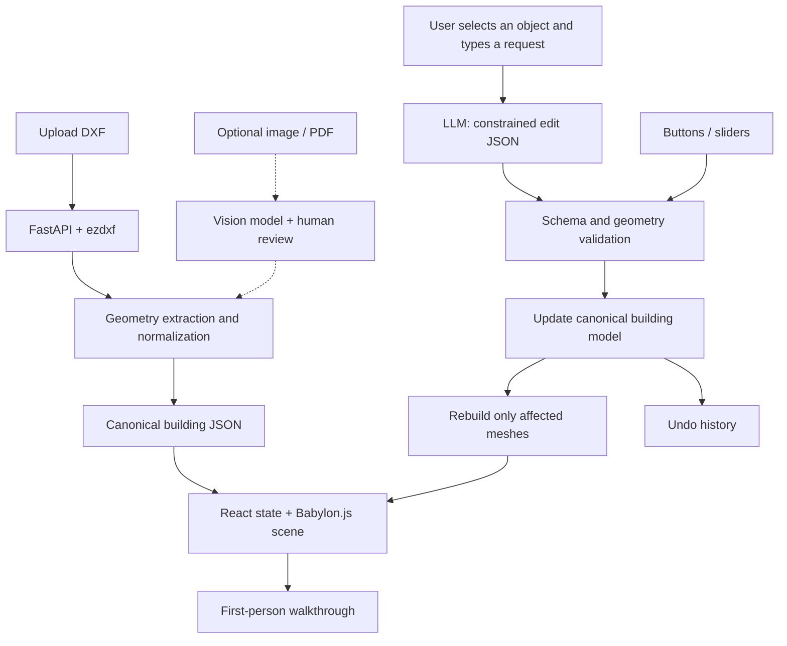

# Walkitecture 🏠🎮

**Don't just see the floor plan. Walk it.**

> **Hackathon project concept · One-day MVP · Planned features, not a claim of completed implementation**

**Walkitecture** turns an architectural floor plan into a **walkable, human-scale 3D experience in the browser**. Clients can explore rooms with game-style controls, understand how large spaces actually feel, and experiment with changes—such as widening windows or moving a selected partition—**without restarting the walkthrough**.

**Pitch:** *Upload a floor plan. Walk through it. Tell the AI what to change. See the difference immediately.*

## The problem

2D architectural drawings communicate measurements, but they're hard for non-architects to experience. A client might be unsure whether a hallway is too narrow, a bedroom feels too small, or a window provides enough visual openness. Conventional CAD and 3D modeling tools can require specialized software and expertise, even when all a client wants is to walk around the proposal.

## Our solution

Walkitecture combines:

1. **Floor-plan ingestion:** Extract precise geometry from a DXF drawing; optionally interpret images or PDFs with a vision-language model (VLM).
2. **Procedural 3D generation:** Convert the extracted layout into walls, openings, floors, and simple materials at a consistent real-world scale.
3. **Browser walkthrough:** Explore the building using WASD + mouse; switch to an overhead view to examine the whole layout.
4. **Live editing:** Change a supported property while walking through the scene; Babylon.js updates the relevant meshes **without a page reload or a camera reset**.
5. **Natural-language edits:** An LLM interprets a request and chooses a **predefined, validated edit operation** instead of generating arbitrary 3D-engine code.

The goal is **spatial understanding and rapid design iteration**, not photorealism or construction-ready BIM.

## What makes Walkitecture different?

- **Experience-first:** A plan becomes a first-person, game-like space instead of only an orbitable 3D model.
- **No client installation:** The walkthrough runs in a modern web browser.
- **Editable while exploring:** A user can stand in a room, request a change, and see it happen in place.
- **AI with guardrails:** Geometry remains structured and deterministic. The AI proposes commands; application code validates and executes them.
- **Designed for quick comparisons:** Keep the same viewpoint while trying a wider window or higher ceiling.

## Demo scenario

1. Upload a small, dimensioned DXF floor plan (for example, a two-bedroom apartment).
2. Walk from the hallway into the living room in first-person mode.
3. Click a window and type: **“Make the selected window 50% wider.”**
4. The AI translates the request into a constrained command, the app checks that the opening fits the wall, and Babylon.js updates the window and surrounding wall segments in the live scene.
5. Type: **“Increase the ceiling height to 3 meters.”** The room updates without leaving the walkthrough.
6. Use **Undo** to compare the original and modified designs.

> **Demo fallback:** If LLM integration is unavailable, buttons and sliders call **the same edit functions**. This preserves a reliable end-to-end live-editing demo.

## Hackathon scope

We have **one day** to build the whole project. Reliability is more important than supporting every file format or architectural edit.

### P0 — Essential: ship a working experience

- [ ] React app containing a Babylon.js scene.
- [ ] Procedural generation from a small, validated JSON building schema.
- [ ] First-person navigation with WASD + mouse and a sensible eye height.
- [ ] A top-down / first-person camera toggle.
- [ ] DXF import for **one constrained, known-good class of drawings** (or a prepared DXF sample).
- [ ] Correct scale based on explicit units or user-provided calibration.
- [ ] At least one real-time change through a button or slider **without reloading**.

### P1 — High-impact enhancements

- [ ] Window resizing with openings reconstructed in the surrounding wall.
- [ ] Change ceiling height while keeping the user's camera active.
- [ ] Click-to-select a wall or window; highlight the selection.
- [ ] Natural-language editing that maps to a small allowlist of operations.
- [ ] Undo last edit; clear validation error messages.
- [ ] Basic collision handling and updates when geometry changes.

### P2 — Stretch goals only

- [ ] Move a **simple, independent** selected wall by a specified offset.
- [ ] Infer the wall a user means from their camera direction via ray picking.
- [ ] PNG/JPEG/PDF plans through a VLM with a human review step.
- [ ] Door/window recognition for less structured DXF files.
- [ ] Room measurements, furniture presets, shareable scene links, or GLB export.

**Out of scope for the one-day MVP:** Arbitrary room redesign, shifting load-bearing walls, automatically preserving every adjacent room when moving partitions, building-code validation, and photorealistic furnishing.

## Proposed tech stack

| Layer | Technology | Responsibility |
| --- | --- | --- |
| Web UI | **React + TypeScript** | Upload, chat, selection, edit controls, and viewport |
| 3D engine | **Babylon.js** | Procedural meshes, cameras, picking, rendering, and collision |
| Backend | **Python + FastAPI** | Plan uploads, DXF parsing, normalized geometry, and optionally LLM requests |
| CAD parsing | **ezdxf** | Read DXF line/polyline entities, layers, blocks, and units |
| AI | **LLM API** | Convert text instructions into structured, allowlisted edit commands |
| Optional vision | **VLM API** | Interpret rasterized floor plans when DXF data isn't available |
| Source of truth | **Versioned JSON building model** | Stable IDs and semantic relationships for edits and rendering |

**Why not Minecraft or SketchUp?** Both can be programmatically useful, but a React + Babylon.js app gives us control over the browser walkthrough and live editing without requiring customers to install a modeling application. **Why not regenerate everything through an LLM?** Deterministic geometry is faster to validate, cheaper to run, and more predictable.

## Architecture



### Core design rule

**Never treat a Babylon.js mesh as the sole source of truth.** Store editable architectural objects in JSON, each with a stable ID and meaningful properties. A renderer converts that model to meshes. Edit commands mutate the **model**, then the renderer updates affected meshes.

This separates **what the building is** from **how it looks on screen**.

## Input: DXF versus images

**DXF first.** Unlike a screenshot, a DXF can store precise numerical endpoints, polygon vertices, block references, layer names, and drawing units. A line's length and angle can be calculated from its coordinates, eliminating pixel-based estimation.

But a DXF is **not automatically a semantic building model**:

- Two parallel lines may represent a wall; physical wall thickness must be inferred from geometry or supplied explicitly.
- `lineweight` is a drawing/display property, **not** automatically physical wall thickness.
- A rectangle may represent a room, table, or symbol; layers or block definitions help identify it.
- Units may be missing or incorrect, requiring manual calibration.
- Some plans lack room, door, or window semantics entirely.

For the MVP, we should constrain input to **2D drawings with clearly identified wall layers and verified units**, and support a sample plan known to parse correctly.

**Images and PDFs are a stretch goal.** A VLM can help identify walls, doors, labels, and dimensions, but its output requires geometric validation and user review. Do not present inferred dimensions as guaranteed accurate.

## Canonical building schema (illustrative)

```json
{
  "schemaVersion": 1,
  "units": "meters",
  "ceilingHeight": 2.7,
  "walls": [
    {
      "id": "wall_12",
      "start": [0, 0],
      "end": [5, 0],
      "thickness": 0.15,
      "height": 2.7,
      "openings": [
        {
          "id": "window_3",
          "type": "window",
          "offset": 1.5,
          "width": 1.2,
          "height": 1.4,
          "sillHeight": 0.9
        }
      ]
    }
  ],
  "rooms": [
    {
      "id": "room_1",
      "name": "Living Room",
      "polygon": [[0, 0], [5, 0], [5, 4], [0, 4]]
    }
  ]
}
```

Here, `offset` is the distance in meters **along the wall from its start point** to the **left edge of the window opening**. All coordinates and dimensions use a consistent meter scale. This is a proposed schema, not an implemented API contract.

### Why stable IDs and relationships matter

- `window_3` belongs to `wall_12`: resizing the window tells the renderer which wall segments must be recreated.
- `wall_12` has endpoints, so the app knows its actual length and direction.
- A selected object can be referenced unambiguously in a user instruction.
- Edits are reversible, since the state before each successful change can be stored.

## Live editing without restarting the walkthrough

Babylon.js renders a live scene continuously. **Modifying meshes or replacing a subset of them does not require reloading the page.** The camera and the rest of the scene can remain intact.

### Editing pipeline

1. **Select an object** by clicking it in the scene (recommended) or by using a property panel.
2. **Describe a change**, for example, “Make this window 50% wider.”
3. **Interpret the text** into a restricted operation with typed arguments.
4. **Validate** that the target exists and new geometry is allowed.
5. **Apply the edit** to a copy of the building JSON and save the previous state for Undo.
6. **Update affected Babylon.js meshes** (for windows, regenerate the opening and its wall segments).
7. **Refresh collision geometry** for changed objects, preserving camera position unless it would intersect new geometry.

The LLM never executes JavaScript, mutates arbitrary meshes, or rewrites the entire scene.

### Allowlisted AI operations

| Operation | Example instruction | Complexity |
| --- | --- | --- |
| `resize_windows` | “Make all windows 20% wider.” | Low–medium; validate against each wall |
| `resize_selected_window` | “Make this window 50% wider.” | Low–medium; rebuild wall opening |
| `set_ceiling_height` | “Raise the ceiling to 3 meters.” | Low–medium; adjust wall heights and dependent geometry |
| `move_selected_wall` | “Move this partition back 30 cm.” | Medium–high; **independent walls only** |

**Relative directions are ambiguous.** For the MVP, require users to click the wall; interpret “back” relative to the camera only when the reference frame is explicitly defined. Otherwise request a direction or show a preview before applying the edit.

### Example LLM output

```json
{
  "operation": "resize_selected_window",
  "targetId": "window_3",
  "parameters": {
    "factor": 1.5
  }
}
```

This is **data**, not runnable code. The app checks the schema and maps it to a known function.

### Example implementation shape (TypeScript pseudocode)

```ts
async function applyEdit(command: EditCommand) {
  const proposed = structuredClone(buildingModel);
  validateCommand(command, proposed);
  const affectedIds = mutateModel(proposed, command);
  validateGeometry(proposed); // lengths, opening bounds, collisions, etc.

  pushUndo(buildingModel);
  buildingModel = proposed;
  updateAffectedMeshes(scene, buildingModel, affectedIds);
  refreshCollisionMeshes(scene, affectedIds);
  // Keep the existing camera and render loop running.
}
```

The functions above are illustrative; they are **not** provided by Babylon.js automatically. Moving a box mesh can be a single transform update, but widening a **real hole in a wall** usually means rebuilding the wall sections around the opening.

### Important validation rules

- All dimensions must be positive, within sane bounds, and in declared units.
- Window/door openings must fit within their parent wall and not overlap invalidly.
- Selected IDs must exist; edit targets and operations must be explicitly allowed.
- Reject edits that introduce obviously degenerate geometry or block essential passages.
- Reject or preview edits that affect connected partitions the MVP cannot safely update.
- Do not move the camera through walls; if a change traps the player, reject it or reposition safely.

**One-day simplification:** Implement **window resizing and ceiling-height changes** before wall movement. Support moving only an isolated demonstration wall if the rest is stable.

## Suggested API (not implemented)

| Endpoint | Purpose |
| --- | --- |
| `POST /api/plans` | Upload DXF and return a plan ID |
| `POST /api/plans/{id}/parse` | Extract and normalize geometry |
| `GET /api/plans/{id}/scene` | Fetch canonical scene JSON |
| `POST /api/interpret-edit` | Turn text + selected ID + model context into a typed edit command |

**Where should edits execute?** For the hackathon, local client-side execution is a good default: send the user instruction for LLM interpretation, but apply validated geometry changes directly in the React/Babylon.js app. If collaborative persistence is added later, store the model and edit history on the backend.

## Suggested development order

| Sequence | Deliverable | Definition of done |
| --- | --- | --- |
| 1 | Static test scene | Walk around a small fixed building in a browser |
| 2 | JSON-driven geometry | Generate the same scene from canonical model data |
| 3 | Local live edit | A UI slider changes window width or ceiling height without resetting the view |
| 4 | DXF conversion | One sample DXF successfully produces a valid model with correct scale |
| 5 | AI command | A natural-language prompt invokes the same validated edit code |
| 6 | Polish | Selection highlight, Undo, room labels, collision fixes |

**Time-saving strategy:** Develop live editing and rendering against a hand-authored JSON model **before** DXF parsing is complete. This lets front-end and parsing work proceed independently and gives the team a fallback if plan ingestion is unreliable.

## Known risks and mitigations

| Risk | Hackathon mitigation |
| --- | --- |
| Inconsistent or messy DXF drawings | Support a narrow known-good drawing convention and sample file |
| Missing or wrong scale | Confirm units or calibrate against a known measurement |
| AI invents geometry or invalid measurements | LLM outputs commands only; deterministic parsing and validation remain authoritative |
| Window size changes but its wall stays solid | Build walls as sections surrounding semantic openings and regenerate affected sections |
| Wall movement breaks neighboring rooms | Defer connected-wall editing; limit to an isolated partition |
| Player collision becomes stale after an edit | Recreate collision-enabled geometry for modified objects |
| AI endpoint is slow or unavailable | Keep sliders and buttons that exercise the same editing operations |
| Too many features for one day | Prioritize working walkthrough → local edits → DXF → AI language interface |

## Future possibilities

- Voice instructions while navigating rooms.
- Compare before/after layouts side by side or via a one-click toggle.
- Furniture and accessibility clearances to evaluate usable space.
- More robust constraints and room adjacency models for intelligent wall movement.
- Multiplayer architect–client walkthroughs.
- Design export to glTF/GLB or interoperability with CAD/BIM tools.

## Limitations and disclaimer

Walkitecture is a **concept/prototype for experiential architectural visualization**. It does not verify building codes, structural safety, accessibility compliance, construction tolerances, or permit requirements. AI-inferred geometry and dimensions must be reviewed against original drawings before being used for real-world decisions.

---

**Walkitecture** — *Real estate, but playable.*
